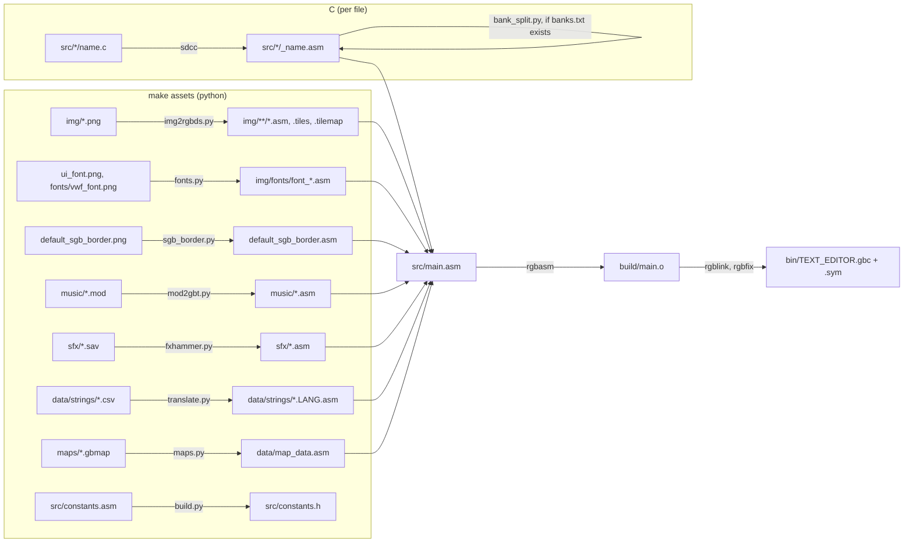
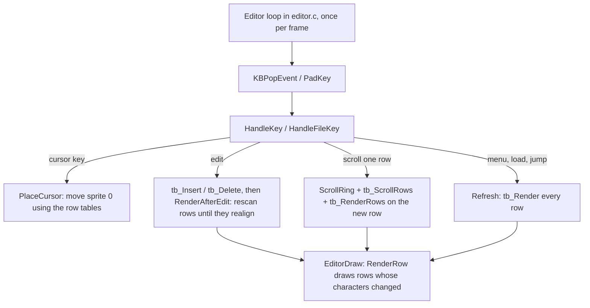
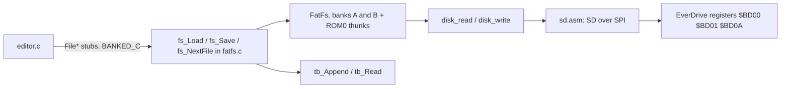

# Architecture

TEXT EDITOR is a Game Boy text editor built on the Béisbol game engine. It runs on DMG, GBC, and SGB, and is meant for the EverDrive GB X-series flash carts, which let it read and write `.txt` files on the SD card. The editor lives in `src/editor` and `src/fatfs`. Everything else in `src` is the engine: graphics, audio, input, maps, UI, and so on. The engine is kept so that future projects can do more than edit text.

This document explains how the pieces fit together. [README.md](README.md) covers controls and build commands, and [TODO.md](TODO.md) tracks known issues.

## Toolchain

| Tool | Used for |
| --- | --- |
| [RGBDS](https://rgbds.gbdev.io/) 1.0 | Assembling (`rgbasm`), linking (`rgblink`), and fixing the header (`rgbfix`) |
| [SDCC](https://sdcc.sourceforge.net/) 4.2 (`-msm83 --asm=rgbds`) | Compiling the C files to RGBDS assembly |
| Python 3 + Pillow | Converting assets (images, fonts, music, sfx, maps, strings) |
| `gcc` | Building `mod2gbt` once |
| `sfdisk`, `mkfs.fat`, `mtools` | Building the SD card image (`make sdcard`) |
| [Gearboy](https://github.com/drhelius/Gearboy) fork | Emulating the PS/2 keyboard and the EverDrive SD card, and debugging over MCP |

The rule of thumb for languages: **assembly** for anything that touches hardware, runs often, or does heavy lifting (drawing, input, memory, the text buffer, SPI). **C** for the higher level logic (the editor's state, menus, the file API). FatFs is C because it is a third-party library.

## Building

- **One assembly unit.** `src/main.asm` includes `src/text_editor.inc`, which includes every module (and each module includes its generated assets and the `_*.asm` output of its C file). `rgbasm` runs once and `rgblink` links a single object. The linker places `SECTION`s into ROM banks, except for a few with fixed banks.
- **Generated files are committed** (`img/**/*.asm`, `*.tiles`, `data/strings/*.asm`, `src/*/_*.asm`, `src/constants.h`, the ROM), so `make assemble` works without Python. The asset scripts skip files that are already up to date.
- **Targets:** `make all` (clean, assets, assemble, run), `make assemble` (just the ROM), `make code` (assemble and run in Gearboy), `make sdcard` (64MB MBR + FAT32 image from `sd/`), `make clean`.
- **Languages:** `LANGUAGE=EN|ES|FR|IT|PT|DE|JA` picks which translated strings `data/strings/*.asm` includes.
- **Constants shared with C:** `build.py` turns `src/constants.asm` (`DEF X EQU ...`) into `src/constants.h` (`#define X ...`). Put anything C needs there, and parenthesize expressions.

## Source layout

| Path | Contents |
| --- | --- |
| `src/main.asm` | Cartridge header, boot sequence, starts the editor |
| `src/text_editor.inc` | Includes every module (the include order matters for macros and constants) |
| `src/editor/` | The editor: main loop and menus (`editor.c`), text buffer, renderer, on screen keyboard, SD card driver |
| `src/fatfs/` | FatFs, its disk glue, and the file API (`fatfs.c` includes everything in `lib/`) |
| `src/keyboard/` | PS/2 and iGKB keyboard drivers |
| `src/audio/` | gbt_player (music) and the FX Hammer sfx player |
| `src/world/` | Map data, map scripts, and meta sprites used by the map loader |
| `src/tests/` | Optional tests that run before the editor (see Testing) |
| `src/core.asm`, `ui.asm`, `color.asm`, `sgb.asm`, `fade.asm`, `tile_anim.asm`, `map_loader.asm` | Engine: drawing helpers, UI widgets, palettes, SGB, fades, tile animations, maps |
| `src/gbdk.asm`, `memory1.asm`, `math.asm`, `strings.asm` | Low level helpers (VBlank waits, sprite/tile copies, memory, 8-32 bit math, strings) |
| `src/far_call.asm` | `FarCall`, used by C split across banks |
| `src/input.asm`, `interrupts.asm` | Joypad, interrupt vectors and handlers |
| `src/charmap.asm`, `constants.asm`, `macros.asm`, `hardware.inc` | Character map, constants, macros, hardware registers |
| `src/wram.asm`, `sram.asm` | Shared WRAM variables and buffers, SRAM layout |
| `img/`, `music/`, `sfx/`, `maps/`, `data/` | Asset sources and their generated assembly |
| `sd/` | Files copied into `bin/sdcard.img` |
| `*.py` | Asset converters (see Building) and `bank_split.py` |

## Boot

`Main` in `src/main.asm`:

1. `SYS_CHECK` reads the boot ROM's registers and sets `sys_info` (DMG, GBC, GBA, SGB).
2. Clears HRAM (except `sys_info`), sets up the SGB (border, palettes), turns the display off, and copies the OAM DMA routine into HRAM.
3. On GBC: double speed, and loads `DefaultPalettes` (8 background + 8 object palettes).
4. Clears WRAM, sets the stack (`stack_bottom`, 1KB), turns audio on, clears the screen, enables VBlank and serial interrupts, and looks for a PS/2 keyboard (`DetectKeyboard`).
5. Runs the tests enabled in `src/constants.asm`.
6. `TRAMPOLINE _Editor`, the C main loop, which never returns.

## Memory map

### ROM

- **ROM0** (`$0000-$3FFF`, always mapped) holds the interrupt handlers, the boot code, and anything called from more than one ROM bank: memory/math/string helpers, the text buffer, the SD driver, the on screen keyboard, the far call thunks, and the editor's C-callable asm. **It's nearly full** (under 1KB free). Move things out when possible.
- **ROMX** (`$4000-$7FFF`, banked) holds everything else. `rgblink` picks the banks. A section is never split across banks, so a section must be under 16KB.

### WRAM

- **WRAM0** (`$C000-$CFFF`): the stack (1KB, FatFs needs a deep stack), the OAM buffer, shared vars (`_a` ... `_z`, `game_state`), keyboard state and queues, text buffer vars, renderer vars, `_font_widths` (256 bytes, page aligned), and all C variables (`--dataseg WRAM0`).
- **WRAMX bank 1** (`$D000-$DFFF`, full on GBC since nothing switches banks): `tile_buffer` (the screen's characters), `bkg_buffer` (what each tile block currently shows), `win_buffer` (chunk buffer for gap moves), `cmd_buffer` (the renderer's row bitmap, page aligned), `str_buffer`, `name_buffer`.

### HRAM

`loaded_bank`, input state, `pad_latch`, interrupt vars, the OAM DMA routine, `vbl_done`, `sys_info`, map loader vars. HRAM is cleared at boot.

### SRAM (MBC5, 4 x 8KB banks, battery backed)

| Bank | Contents |
| --- | --- |
| 0-2 | The text buffer (24,528 bytes). `$BD00-$BD0F` is never used in any bank (see EverDrive registers) |
| 3 | `sram_tb_signature` ("TXT2") and the engine's save data at `$A000`, the clipboard at `$A040-$BCFF` (length, its complement, then up to 7356 characters) |

SRAM is only enabled (`SRAM_ON`) while it's being read or written, so a power loss is less likely to corrupt it.

## Banking and calling conventions

- **`loaded_bank`** (HRAM) always holds the ROM bank that's mapped. `SET_BANK` writes it and the MBC5 register together. Never write `rROMB0` directly.
- **`TRAMPOLINE Label`** calls `Label` in another bank from asm and switches back. Arguments can only go in `a`, `de`, and RAM.
- **C calling convention** (SDCC 4.2, `sdcccall(1)`): the first argument goes in `a` (8 bit) or `de` (16 bit). The second goes in `e` if the first was in `a`, otherwise `a` (8 bit) or `bc` (16 bit). The rest go on the stack, and the callee removes them. Return values: 8 bit in `a`, 16 bit in `bc`, 32 bit in `debc`. C sees asm labels that start with `_` (`_tb_Insert::` is `tb_Insert()` in C).
- **C code is banked.** Each C file's code lands in a ROMX section. C can call ROM0 asm, and C in its own bank, but not code in other banks. To call C in another bank from C, add a ROM0 stub with `BANKED_C` (`src/macros.asm`). It keeps `a`, `de`, `bc` arguments and return values, so it only works for functions with no stack arguments. The FatFs file API (`FileLoad` etc. in `src/fatfs/fatfs.asm`) is called this way.
- **C files too big for one bank** (FatFs, ~21KB) are split by `bank_split.py`, which runs after SDCC when a `banks.txt` sits next to the `.c` file. It moves listed functions into `ROM0` or a second bank `B` (unlisted functions stay in `A`, data goes to ROM0), and rewrites every call or jump between banks to go through a generated ROM0 thunk. The thunk saves the caller's bank and return address on a WRAM stack and jumps to `FarCall`, so stack arguments stay where the callee expects them.
- **C restrictions** (SDCC's libraries aren't linked, only RGBDS objects are):
  - Static initializers don't run (`_GSINIT` is never called). Initialize globals in code. WRAM is zeroed at boot.
  - 32 bit multiply and divide use our own `_mullong`/`_divulong` in `src/fatfs/lib/runtime.c`. `memcpy`, `memset`, `memcmp`, `strchr` are in `src/fatfs/fatfs.c`. Avoid 16 bit `*` and `/` in other C.
  - String literals go through the RGBDS charmap, which maps `"\n"` to 128. Use character literals (`'\n'` is 10).
- **SDCC pitfalls:** always compile through the Makefile's flags (`--no-peep --peep-file peephole.def`). Plain `sdcc --asm=rgbds` emits stores through a stale `hl`. SDCC 4.2 also clobbered `hl` in an expression that read a `signed char` global (see `RenderAfterEdit`). If C misbehaves, read the generated `_*.asm`.

## Interrupts

| Vector | Handler | Does |
| --- | --- | --- |
| VBlank | `VBLInterrupt` | OAM DMA, `LatchPad` (records new button presses), time, map/sprite animations (paused by the editor), audio |
| STAT | `LCDInterrupt` | Jumps to the address in `rLCDInterrupt` (`SetLCDInterrupt`). The editor uses `RenderLCDInterrupt` |
| Serial | `SerialInterrupt` | Reads the rest of a PS/2 scan code bit by bit and queues it |
| Timer, joypad | | unused |

## Input

- **Joypad:** `UpdateInput` (called by `WaitFrame` every frame) reads the buttons into `button_state`/`last_button_state` and processes queued keyboard scan codes. Because a screen refresh can take several frames, the VBlank handler also latches new presses into `pad_latch`. The editor reads them with `PadPressed()` so short presses aren't lost.
- **PS/2 keyboard** (`src/keyboard`): the keyboard clocks bits into the link port. `PS2KeyboardInterrupt` assembles 11-bit frames into a 64-entry scan code ring. `ProcessKeyCodes` decodes scan codes through jump tables (`kb_jump_table.asm`) into handlers, which act according to `kb_mode`:
  - `KB_MODE_BUTTONS`: keys act as joypad buttons (Z = A, X = B, arrows, enter = START).
  - `KB_MODE_TYPING`: keys drive the engine's name entry screen.
  - `KB_MODE_EDITOR`: key presses are queued as events (key + modifiers) for `KBPopEvent`. Printable keys use their character code, special keys use `KEY_*` codes from `src/constants.asm`.
- The link port can't send data to the keyboard, so caps lock and the keyboard's LEDs aren't supported. In Gearboy, Caps Lock enables the emulated PS/2 keyboard. The keyboard is only detected at boot.
- **iGKB** (USB keyboard adapter) handlers exist but detection is disabled.

## The editor

### Main loop (`src/editor/editor.c`)

Each frame `Editor()` waits for VBlank, pops keyboard events, and reads the joypad (`PadKey`, which also drives the on screen keyboard). `HandleKey` sets one of these flags:

| Flag | Meaning | Work done |
| --- | --- | --- |
| `moved` | The cursor moved, the text didn't change | `PlaceCursor` finds the cursor's row in `tb_row_starts` and moves the sprite |
| `edited` | One insert or delete | `RenderAfterEdit` rescans from the row before the edit until a row starts where it used to, plus or minus the edit |
| `redraw` | Rows were scanned without the text changing (scrolling) | `EditorDraw` |
| `dirty` | Anything else (menus, loading, several edits at once) | `Refresh` renders every row and scrolls to keep the cursor visible |

Menus (`Choose`), messages, and the save as prompt draw characters straight into `tile_buffer` rows and call `EditorDraw`. File operations call into FatFs through the `File*` stubs. When the editor isn't running on an EverDrive, it moves the text buffer's gap to the end a little at a time once input stops (`tb_NormalizeStep`).

### Text buffer (`src/editor/text_buffer.asm`)

A [gap buffer](https://en.wikipedia.org/wiki/Gap_buffer) in SRAM banks 0-2. Positions are logical (the gap excluded). Physical offsets include the gap and map to a bank and address, skipping `$BD00-$BD0F` in each bank.

- **The gap is always zeroed and text never contains 0**, so `tb_Load` recovers the buffer from SRAM with no metadata: text, zeros, text. When the gap is at the end, the `.sav` file reads as plain text.
- **Gap moves** (`TBMoveGap`) copy runs of up to 256 bytes that don't cross a bank or the register hole, through `win_buffer` when the banks differ, and zero what they leave behind. The gap only moves when text is edited away from it. On an EverDrive, where files are saved to SD, the gap stays put. Elsewhere it's moved to the end when idle so the `.sav` is the only copy you need.
- **Rows** (`TBScanRow`) are up to 160 pixels (character widths from `_font_widths`) and 40 characters. A row ends after a line feed, wraps after the last space when a word doesn't fit, and lets spaces and a line feed after a full row hang off its end. Control characters are drawn as spaces.
- **Row tables:** rendering records `tb_row_starts` (where each visible row starts, then the row after the last), `tb_row_counts` (characters drawn), and `tb_end_row` (the row the end of the text is on). Cursor movement, partial rendering, and scrolling all work from these instead of scanning SRAM.
- **Selection and clipboard:** `tb_DeleteRange` grows the gap over a range, `tb_Copy` copies a range to the clipboard in SRAM bank 3 and `tb_Paste` inserts it, both 256 bytes at a time through `win_buffer`. The editor keeps the selection as `anchor` and `cursor`.
- `tb_Render` (all rows), `tb_RenderRows` (a range), and `tb_ScrollRows` (shift `tile_buffer` and the tables one row) fill `tile_buffer`, which holds 18 rows of `TB_STRIDE` (40) characters.

### Rendering (`src/editor/render.asm`)

Text is drawn as pixels so fonts can be any width. Every screen cell has its own tile, which takes 360 tiles, but the background can only address 256 at a time. So:

- **Tile blocks:** each row draws into a block of 20 tiles. The 18 blocks are kept in a ring: blocks 0-5 are only reachable with `$8000` tile data, 9-14 only with `$8800`, and 6-8 and 15-17 use tiles both modes can reach. Tiles 0 and 1 are the cursor and keyboard highlight sprites.
- **Mode switches:** `RenderLCDInterrupt` switches the tile data mode partway down the screen, at most twice per frame, in the middle of a shared band. The PS/2 interrupt can delay the switch by several lines without anything showing.
- **Scrolling** rotates the ring by one block: the block that leaves the screen draws the new row, its BG map row is pointed at it, and SCY moves 8 pixels. The new SCY and switch points are staged in `render_pending_*` and applied together at line 144. Only whole rows scroll, because there aren't tiles for a 19th row on DMG.
- **Row cache:** `bkg_buffer` holds the characters each block shows and `row_font` its font. `RenderRow` skips rows that haven't changed, so after a scroll or an edit only one or two rows are drawn.
- **Drawing a row:** glyphs are ORed into a 160x8 1bpp bitmap with 4KB of precomputed shift tables (in the renderer's bank, 4KB aligned), then each byte is written to VRAM, 4 bytes per HBlank. Bitplane 1 is the byte and bitplane 0 is the byte XOR the tile's selection mask, so text is color 3 on color 0 and selected text is color 2 on color 1.
- **Selection:** before drawing, the editor sets `render_sel` (first and end column of each row, end `$FF` for the right edge) from the selection and the row tables. A row whose selection changed is redrawn. The palettes set in `EditorSetup` show colors 1 and 2 as inverted on DMG (BGP) and as a blue highlight on GBC and SGB (palette 0). The cursor turns white at the start of a selection (OBP1) so it shows on DMG.
- **Fonts:** `fonts.py` converts `img/ui_font.png` (fixed width, 8 pixels) and `img/fonts/vwf_font.png` (variable width) into 8 bytes of 1bpp glyph rows and a width per character code. Rows below `tb_rows` (the on screen keyboard) always use the fixed width font.
- **Cursor:** sprite 0, a 1 pixel line. `RenderCursorX` adds up character widths in the cursor's row.

### On screen keyboard (`src/editor/osk.asm`)

Five rows of ten keys drawn into the bottom rows of `tile_buffer` (the text area shrinks to 13 rows). Layers are lowercase, shift (one shot), and symbols, the last row is shift, symbols, space, menu, left, right. Sprite 1, behind the background, highlights the selected key.

## SD card and files

- **EverDrive registers** live in cartridge RAM space and respond after `$A5` is written to `$BD0A`: `$BD00` SPI data, `$BD01` SPI control (busy, auto read, slow clock, chip select). `sd.asm` disables SRAM before using them and locks them again afterwards. In case writing `$A5` to `$BD0A` unlocks them even while SRAM is enabled, the text buffer never stores anything at `$BD00-$BD0F`. `~/Projects/everdrive-gb` (a disassembly of the EverDrive OS) documents the rest of the registers.
- **`sd.asm`** detects the EverDrive (`sd_Detect` reads back the SPI control register), initializes SD v1/v2/SDHC cards, and reads and writes 512 byte sectors. It's based on TXTReaderGB's diskio.
- **FatFs** R0.16 (`src/fatfs/lib`, configured in `ffconf.h`: FAT only, 8.3 names, minimized, tiny buffers) is compiled as part of `fatfs.c`, a single C file that also holds the disk glue, the SDCC runtime helpers, and the file API. `banks.txt` splits it across two ROM banks.
- **File API:** `fs_Load` replaces the text buffer with a file, dropping CRs and remembering that the file used CR LF (`fs_crlf`). `fs_Save` writes the buffer (around the gap) and adds the CRs back. `fs_NextFile` lists `.TXT` files in the root folder.
- **Gearboy** emulates the EverDrive's SD card on MBC5 carts (menu "EverDrive X SD Card", or `GEARBOY_EVERDRIVE=0` to turn it off) using `sdcard.img` next to the ROM or `GEARBOY_SD_IMAGE`.

## Engine modules

These aren't used by the editor yet, but they work and are kept for future projects:

- **Maps** (`map_loader.asm`, `src/world`, `maps/`): chunked maps with stamps, tile fills, avatars, meta sprites, collisions, doors, text, and scripts, made in gbmapeditor, a Unity project: edit a scene (`MapTest.unity` started as a copy of `Overworld.unity`) and export it as a `.gbmap`. `MAP_TEST_ENABLED` loads `MapTest.gbmap`.
- **Audio** (`src/audio`): gbt_player plays `.mod` music converted by `mod2gbt`, and FX Hammer sound effects (`sfx/`) play on top, muting music channels by priority.
- **UI** (`ui.asm`): boxes, revealed text, list menus, number pickers, and the text entry screen with its own on screen keyboard. These use the 8x8 font tiles (`UILoadFontTiles`), not the editor's renderer.
- **Color and SGB** (`color.asm`, `sgb.asm`, `fade.asm`): GBC palettes and attribute maps, SGB packets (palettes, attribute blocks, borders, sound), and fades.
- **Tile animations** (`tile_anim.asm`): scrolling, sine, and texture animations on tile data.
- **Text and translations:** `src/charmap.asm` maps characters to tile indices. Tile index matches the character code (ASCII, Latin-1 for accents, UI glyphs in 0-31). Engine strings come from CSVs in `data/strings`, converted by `translate.py`, and use 128 for a new line. The editor's text uses 10.

## Testing and debugging

- Enable `TESTS_ENABLED` and one of `SOUND_TEST_ENABLED`, `KEYBOARD_TEST_ENABLED`, `MAP_TEST_ENABLED`, or `SD_TEST_ENABLED` in `src/constants.asm`. Tests run before the editor starts.
- `bin/TEXT_EDITOR.sym` has every label, so emulators show symbols. `build/main.map` shows where every section landed and how much space each bank has left.
- Gearboy can be driven by an AI assistant or script over MCP (`--mcp-stdio` or `--mcp-http`, add `--headless` to run without a window). Its profiler shows cycles per function, which is how the editor's performance work was measured.
- When changing the text buffer or renderer, compare the screen after an incremental update with a full redraw (open and cancel the menu forces one), and compare saved files byte for byte. Check SD images with `fsck.fat -n` after writing to them.

## Conventions

- Assembly is terse: short `;` comments, routine headers that list register arguments and results (`;de = pos, returns char in a`), local `.labels`, and a list of public routines at the top of each module.
- Labels for C start with `_`, and asm routines called from C get a `_Name::` label. C prototypes for asm live in the C file's header (`src/editor/editor.h`).
- Each module includes `src/text_editor.inc` first, so it can be read on its own.
- Generated files are committed alongside their sources.
