# FatPak OS

FatPak is an operating system for the Game Boy that runs on the EverDrive GB X7.

- Browse, copy, move and rename files and folders on the SD card
- Write text with the on-screen keyboard or a PS/2 keyboard
- Markdown is styled; C and RGBDS assembly are syntax highlighted
- Assemble an `.asm` file into a `.gb` ROM on the Game Boy, and run it
- Launch games with battery saves, RTC, save states and cheats compatible with the stock EverDrive OS
- View binary files as hex, `.tiles`, `.tile` and `.2bpp` files as tiles, and Beisbol `.gbmap` maps (assembled on the device, cached, scrolled like the game)
- Light and dark themes

| | Game Boy Color | Game Boy | GBC (Dark) | DMG (Dark)
| --- | --- | --- | --- | --- |
| File browser | 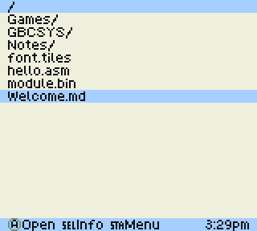 | 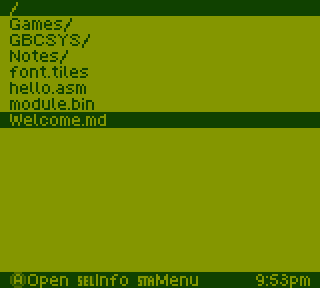 | 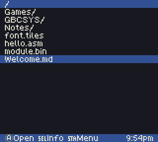 | 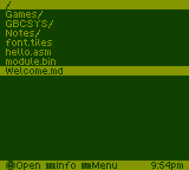 |
| Markdown | 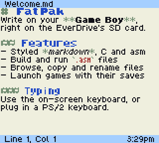 | 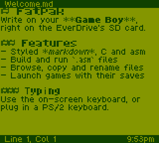 | 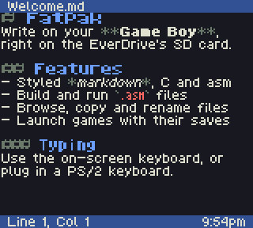 | 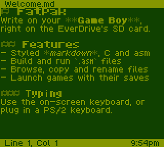 |
| On-screen keyboard | 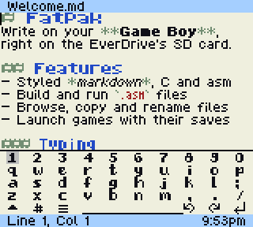 | 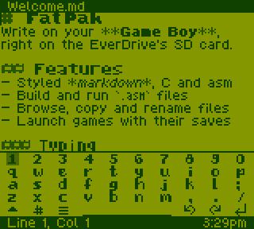 | 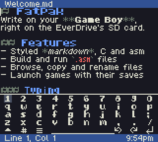 | 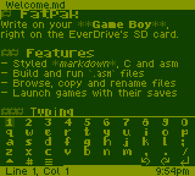 |
| Assembly | 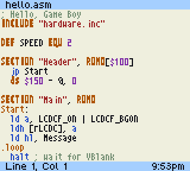 | 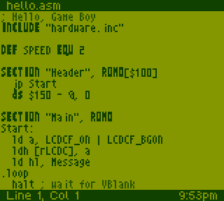 | 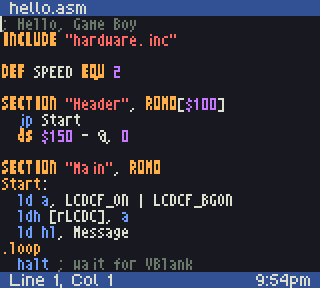 | 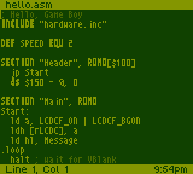 |
| Menu | 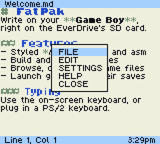 | 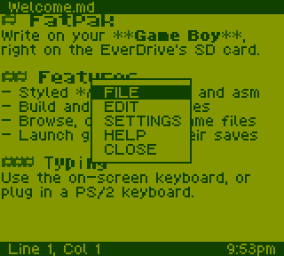 | 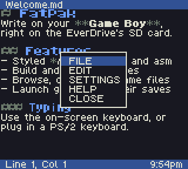 | 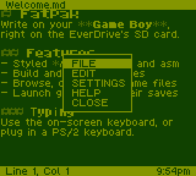 |
| File info | 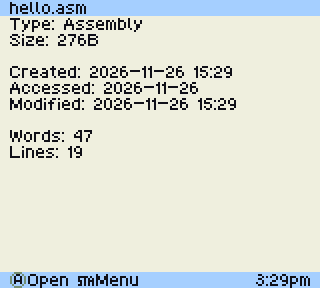 | 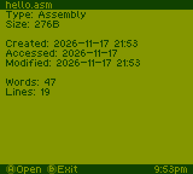 | 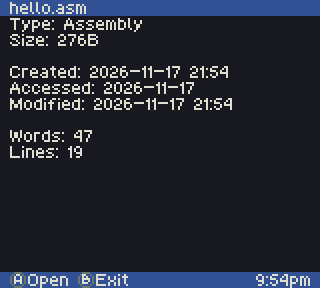 | 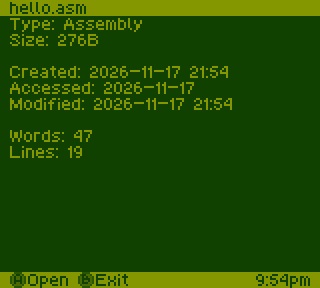 |
| Hex view | 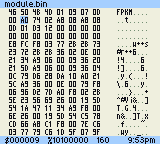 | 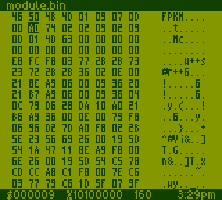 | 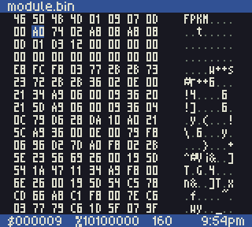 | 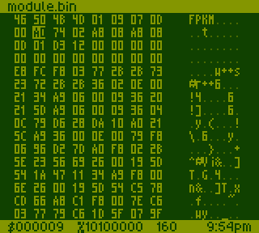 |
| Tile view | 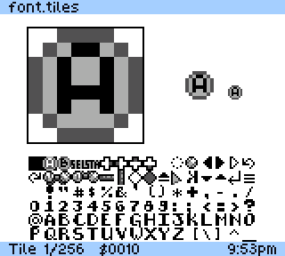 | 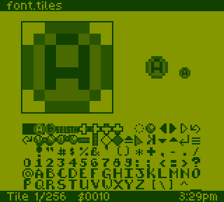 | 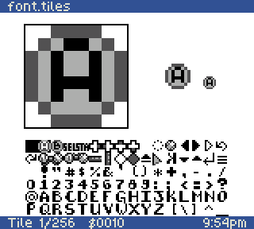 | 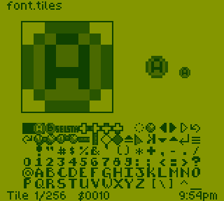 |

Super Game Boy fullscreen (light and dark themes):

| | SGB | SGB (Dark) |
| --- | --- | --- |
| File browser | 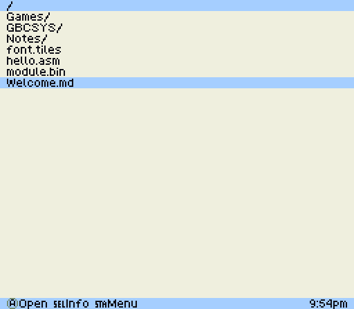 | 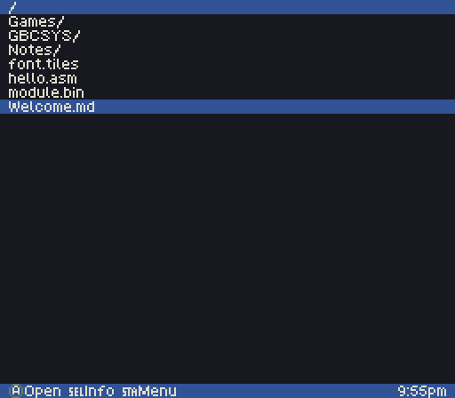 |
| Markdown | 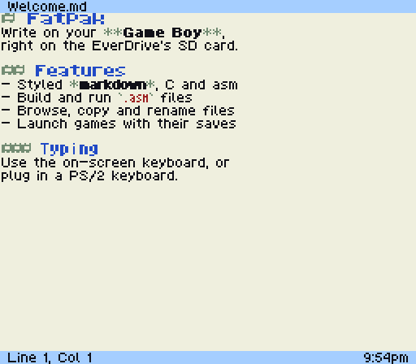 | 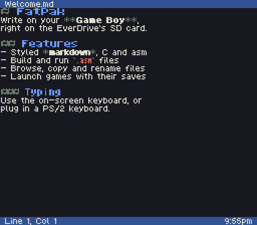 |
| On-screen keyboard | 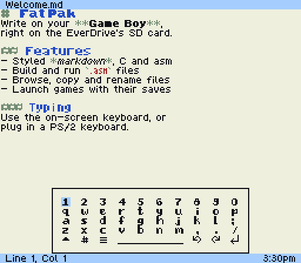 | 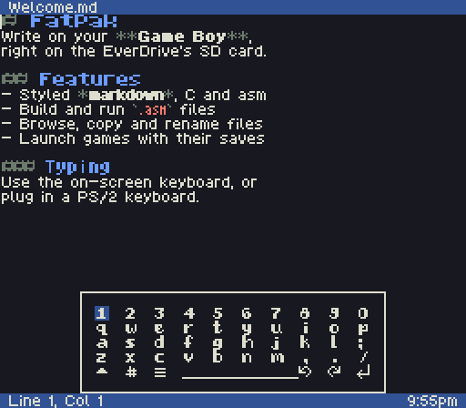 |
| Assembly | 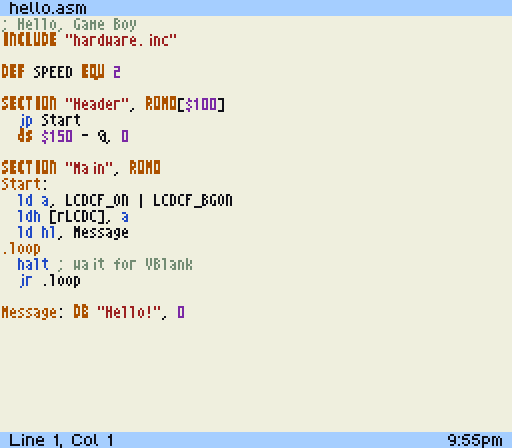 | 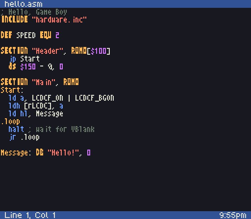 |
| Menu | 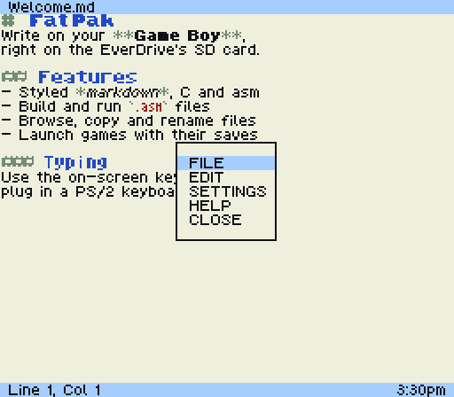 | 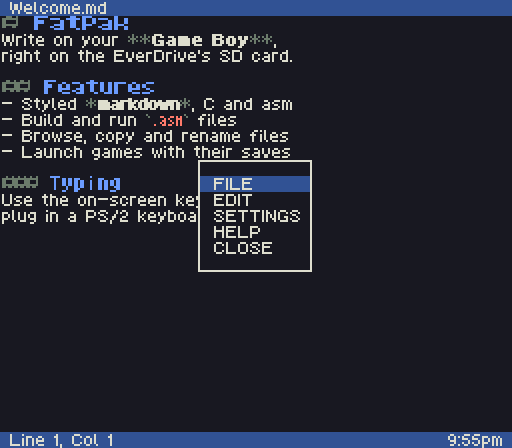 |

# Using it

FatPak reopens whatever you had open when the power went off. HELP in either menu (or F1) shows the
controls on the Game Boy.

**File browser.** The D-pad moves, A opens a file or folder, B goes up a folder, SELECT shows file
info and START opens the menu (rename, cut, copy, paste, settings, help, restart). Text files open in
the editor, `.gb` and `.gbc` files launch, `.tiles`, `.tile` and `.2bpp` files open in the tile viewer, `.gbmap` maps in the map viewer (the
D-pad scrolls, B held runs, the header and footer say where you are, START opens its menu: Rebuild, Full screen, Close; in SGB fullscreen the SNES draws it at 256x224, or 512x448 with the menu's Hi-res) and other binary files in the hex viewer. The viewers are read only; B goes back (from a map, its menu's Close). On a keyboard, Escape is START everywhere.

**Text editor.**

| Button | Action |
| --- | --- |
| D-pad | Move the cursor, or the keyboard selection when it's open |
| A + D-pad | Select text (keyboard closed) |
| A | Type the selected key |
| B | Backspace (keyboard open) |
| B + D-pad | Page up/down, home, end (keyboard closed) |
| SELECT | Show or hide the on-screen keyboard |
| START | Open or close the menu |

The menu has FILE (open, save, save as, new, build, run), EDIT (undo, redo, cut, copy, paste,
select all), SETTINGS (line wrap, full screen, theme, language, clock, keyboard, font; resolution on an SGB),
HELP and CLOSE. Every screen's menu has FILE, EDIT, SETTINGS, HELP and CLOSE (RESTART in the browser);
in the viewers FILE is open as and info (and rebuild for a map), EDIT is copy. Full screen only hides the
header and footer. Font is standard (proportional text, 4 px code) or 8x8 tiles: every document and the
browser in the 8 px mono font, a character a cell. Resolution lists what works there: 160x144 (the SGB's own, kept at boot) and 256x224 in
the SGB's BIOS mode, 256x224 in fullscreen, and 512x448 too in the map viewer.

A PS/2 keyboard works like a PC's: arrows, home/end, page up/down, Ctrl to move by word,
Shift to select, and Ctrl+Z/Y/X/C/V/A/S/O/N. Escape opens the menu, F1 shows help, F5 runs,
F7 builds, F11 toggles full screen, Alt+Z toggles line wrap.

**Games.** The game's save is kept in `/GBCSYS/SAVE/` like the stock EverDrive OS. The cartridge's
menu button combo (Select+Start by default) opens Resume, Save state, Load state and Return to OS.
See [EverDrive compatibility](notes/EVERDRIVE.md).

**Super Game Boy.** FatPak starts in a fullscreen SNES interface, with a centered keyboard
over the document. Keep the matching `SGB.DAT` alongside the OS. The gamepad uses the same
controls as DMG and GBC; see [SGB](notes/SGB.md) for setup and testing.
A gamepad in SNES port 1 and mouse in port 2 work with **SETTINGS > KEYBOARD > SNES MOUSE**
([setup and testing](notes/KEYBOARD.md#snes-mouse-super-game-boy)).
In the sibling Gearboy build, select **Emulator > Force Super Game Boy**, then reset or reload
`GBCOS.BIN`. Automatic selection prefers GBC mode for this dual-compatible ROM.

# Building

Needs [RGBDS](https://rgbds.gbdev.io/) 1.0, [SDCC](https://sdcc.sourceforge.net/) 4.2, Python 3
with Pillow, and cc65 (ca65/ld65 for the SNES mouse bridge).

    make all        # assets, OS image and modules, then run
    make assemble   # just the OS image and modules

The language (English or Spanish) is a setting: SETTINGS > LANGUAGE ([Languages](notes/LANGUAGES.md)).

Copy `bin/GBCOS.BIN`, `bin/EDITOR.DAT`, `bin/SGB.DAT`, `bin/MODULES/`, `bin/LANG/` and `bin/DRIVERS/` to `/GBCSYS/` on the SD card
(`make assemble` does this when the card is mounted at `/media/qbertreynolds/GAMEBOY`).

Tests and the emulator setup are in [Architecture](notes/ARCHITECTURE.md#testing-and-debugging).
`scripts/screenshots.sh` retakes these screenshots using Gearboy for DMG/CGB and
Mesen with FatPak's SNES renderer for SGB. It needs the SGB BIOS and boot ROM
(`SGB_BIOS` and `SGB_BOOT`; defaults: `~/Downloads/program.rom` and `~/Downloads/sgb1.boot.rom`).

# Notes

- [Architecture](notes/ARCHITECTURE.md): how it's built, memory, rendering, editor internals
- [EverDrive compatibility](notes/EVERDRIVE.md): game files, saves and limits
- [Modules](notes/MODULES.md): loadable `.MOD` features
- [Assembler](notes/ASSEMBLER.md): the on-device RGBDS subset
- [Fonts](notes/FONTS.md): font images and how they're converted
- [In-game menu](notes/GAME_MENU.md): the cartridge menu, capture and restore
- [TODO](notes/TODO.md); plans for [SGB](notes/SGB.md) and an [image viewer](notes/IMAGE_VIEWER.md)
