# FatPak OS

FatPak is an operating system for the Game Boy that runs on the EverDrive GB X7.

- Browse, copy, move and rename files and folders on the SD card
- Write text with the on-screen keyboard or a PS/2 keyboard
- Markdown is styled; C and RGBDS assembly are syntax highlighted
- Assemble an `.asm` file into a `.gb` ROM on the Game Boy, and run it
- Launch games with battery saves, RTC, save states and cheats compatible with the stock EverDrive OS
- View binary files as hex, and `.tiles` files as tiles
- Light and dark themes

| | Game Boy Color | Game Boy | GBC (Dark) | DMG (Dark)
| --- | --- | --- | --- | --- |
| File browser | 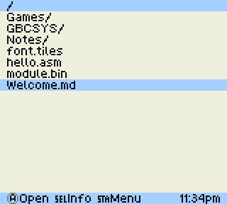 | 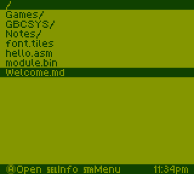 | 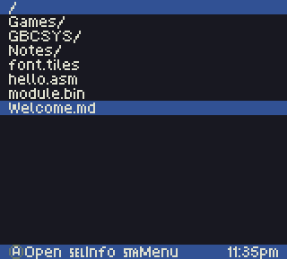 | 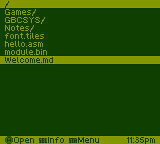 |
| Markdown | 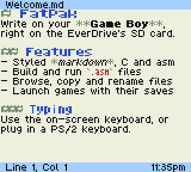 | 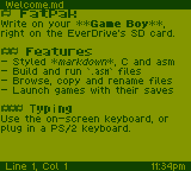 | 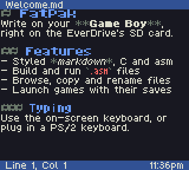 | 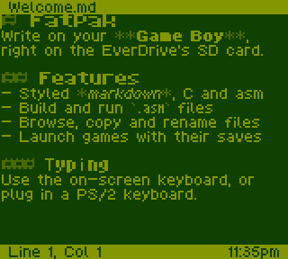 |
| On-screen keyboard | 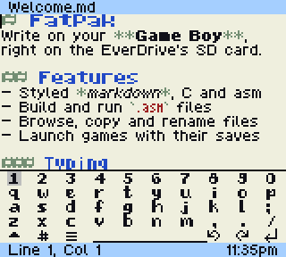 | 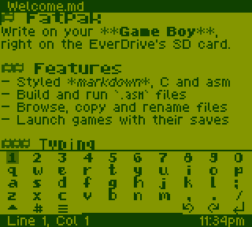 | 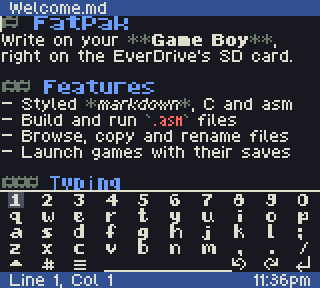 | 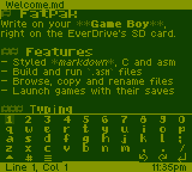 |
| Assembly | 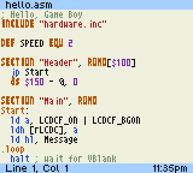 | 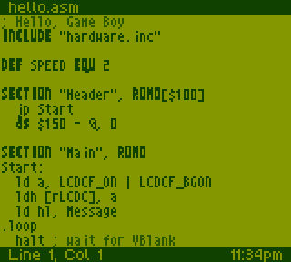 | 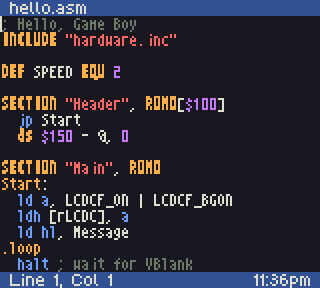 | 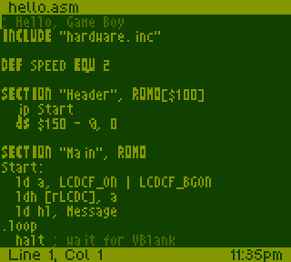 |
| Menu | 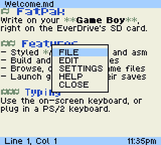 | 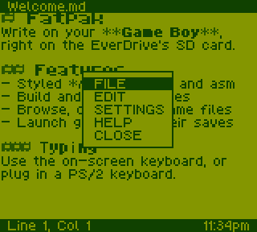 | 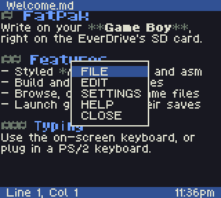 | 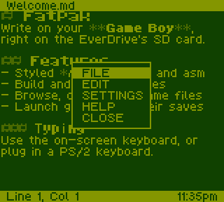 |
| File info | 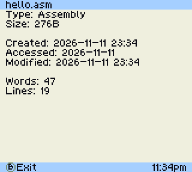 | 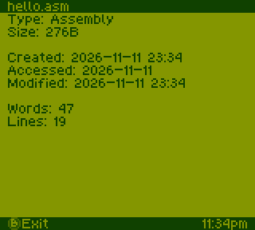 | 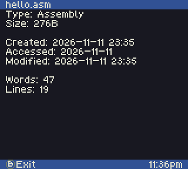 | 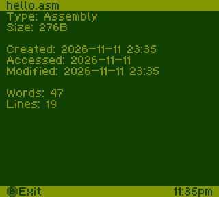 |
| Hex view | 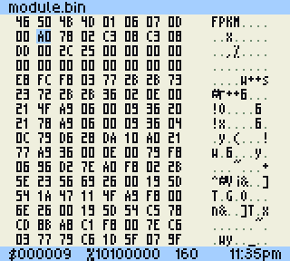 | 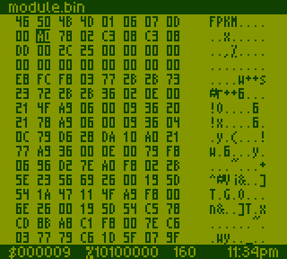 | 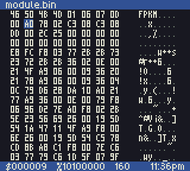 | 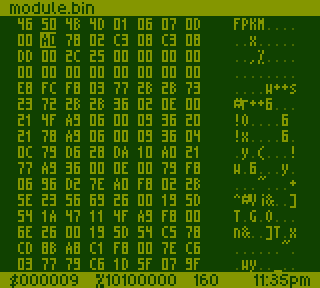 |
| Tile view | 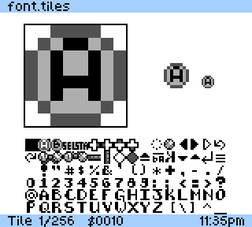 | 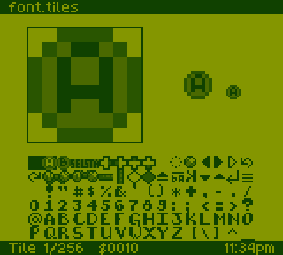 | 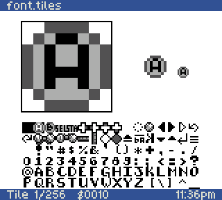 | 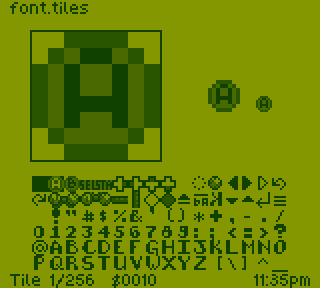 |

# Using it

FatPak reopens whatever you had open when the power went off. HELP in either menu (or F1) shows the
controls on the Game Boy.

**File browser.** The D-pad moves, A opens a file or folder, B goes up a folder, SELECT shows file
info and START opens the menu (rename, cut, copy, paste, settings, help, restart). Text files open in
the editor, `.gb` and `.gbc` files launch, `.tiles` files open in the tile viewer and other binary
files in the hex viewer. Both viewers are read only; B goes back.

**Text editor.**

| Button | Action |
| --- | --- |
| D-pad | Move the cursor, or the keyboard selection when it's open |
| A + D-pad | Select text (keyboard closed) |
| A | Type the selected key |
| B | Backspace |
| B + D-pad | Page up/down, home, end (keyboard closed) |
| SELECT | Show or hide the on-screen keyboard |
| START | Open or close the menu |

The menu has FILE (open, save, save as, new, build, run), EDIT (undo, redo, cut, copy, paste,
select all), SETTINGS (line wrap, full screen, theme), HELP and CLOSE.

A PS/2 keyboard works like a PC's: arrows, home/end, page up/down, Ctrl to move by word,
Shift to select, and Ctrl+Z/Y/X/C/V/A/S/O/N. Escape opens the menu, F1 shows help, F5 runs,
F7 builds, F11 toggles full screen, Alt+Z toggles line wrap.

**Games.** The game's save is kept in `/GBCSYS/SAVE/` like the stock EverDrive OS. The cartridge's
menu button combo (Select+Start by default) opens Resume, Save state, Load state and Return to OS.
See [EverDrive compatibility](notes/EVERDRIVE.md).

# Building

Needs [RGBDS](https://rgbds.gbdev.io/) 1.0, [SDCC](https://sdcc.sourceforge.net/) 4.2 and Python 3
with Pillow.

    make all        # assets, OS image and modules, then run
    make assemble   # just the OS image and modules

The language (English or Spanish) is a setting: SETTINGS > LANGUAGE ([Languages](notes/LANGUAGES.md)).

Copy `bin/GBCOS.BIN`, `bin/EDITOR.DAT`, `bin/MODULES/` and `bin/LANG/` to `/GBCSYS/` on the SD card
(`make assemble` does this when the card is mounted at `/media/qbertreynolds/GAMEBOY`).

Tests and the emulator setup are in [Architecture](notes/ARCHITECTURE.md#testing-and-debugging).
`scripts/screenshots.sh` retakes these screenshots in the emulator.

# Notes

- [Architecture](notes/ARCHITECTURE.md): how it's built, memory, rendering, editor internals
- [EverDrive compatibility](notes/EVERDRIVE.md): game files, saves and limits
- [Modules](notes/MODULES.md): loadable `.MOD` overlays
- [Assembler](notes/ASSEMBLER.md): the on-device RGBDS subset
- [Fonts](notes/FONTS.md): font images and how they're converted
- [In-game menu](notes/GAME_MENU.md): the cartridge menu, capture and restore
- [TODO](notes/TODO.md); plans for [SGB](notes/SGB.md) and an [image viewer](notes/IMAGE_VIEWER.md)