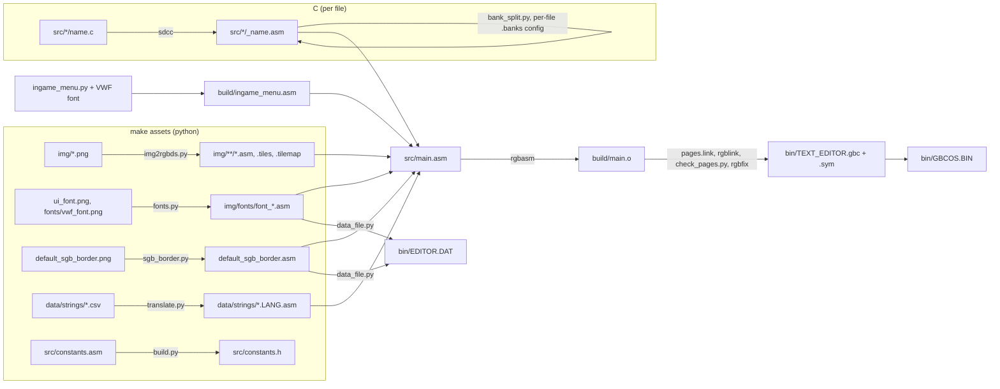
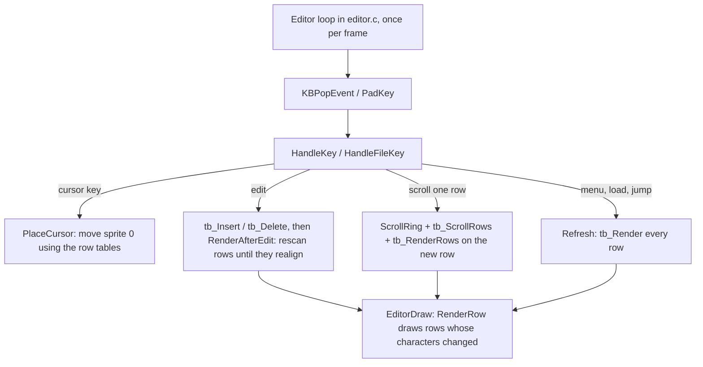
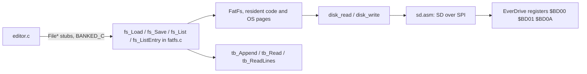

# Architecture

Girlboss is a Game Boy text editor and game launcher derived from the Béisbol
engine. The application is a single 128 KiB EverDrive GB X7 OS image for DMG,
CGB and SGB. It includes SD file editing, PS/2 input, styled text rendering,
stock-compatible game saves, RTC support, save states and Game Genie patches.
The old engine audio player and tile-based UI module have been removed.

[README](../README.md) covers controls and builds; [TODO](TODO.md) tracks remaining
work. [EverDrive compatibility](EVERDRIVE_FEATURES.md) describes file formats, and
[In-game menu](IN_GAME_MENU.md) describes capture/restore in detail. Source paths
and commands below are relative to the repository root.

## Toolchain

| Tool | Used for |
| --- | --- |
| [RGBDS](https://rgbds.gbdev.io/) 1.0 | Assembling (`rgbasm`), linking (`rgblink`), and fixing the header (`rgbfix`) |
| [SDCC](https://sdcc.sourceforge.net/) 4.2 (`-msm83 --asm=rgbds`) | Compiling the C files to RGBDS assembly |
| Python 3 + Pillow | Converting assets (images, fonts, strings, menu graphics) |
| [Gearboy](https://github.com/drhelius/Gearboy) fork | Emulating PS/2 input, EverDrive OS mapping, SD, RTC and the cart button; debugging over MCP |

The rule of thumb for languages: **assembly** for anything that touches hardware, runs often, or does heavy lifting (drawing, input, memory, the text buffer, SPI). **C** for the higher level logic (the editor's state, menus, the file API). FatFs is C because it is a third-party library.

## Building

- **One assembly unit.** `src/main.asm` includes `src/text_editor.inc`, which includes every module (and each module includes its generated assets and the `_*.asm` output of its C file). `rgbasm` runs once and `rgblink` links a single object. The only application build is the EverDrive OS image. `pages.link` places its resident code and page fragments; `check_pages.py` verifies the layout.
- **Generated files are committed** (`img/**/*.asm`, `*.tiles`, `data/strings/*.asm`, `src/*/_*.asm`, `src/constants.h`, the ROM), so `make assemble` needs no asset regeneration; it still uses Python for page splitting, the menu, layout checks and the data file. The asset scripts skip files that are already up to date.
- **Targets:** `make all` (clean, assets, assemble, run), `make assemble` (OS image, symbols and data file), `make code` (assemble and run in Gearboy), `make assets`, `make run`, and `make clean`. There is no `make sdcard` target. The legacy `fxhammer.py` invocation remains in `assets`, but no audio player is included in the application.
- **Languages:** `LANGUAGE=EN|ES|FR|IT|PT|DE|JA` picks which generated strings `data/strings/*.asm` includes. Editor, clock and cart-menu labels still contain hard-coded English text.
- **Installation:** every successful `make assemble` checks whether `/media/qbertreynolds/GAMEBOY` is mounted. If it is, the build copies `bin/GBCOS.BIN` into its `GBCSYS` folder and flushes the write. Install `bin/EDITOR.DAT` alongside the OS for styled fonts and the SGB border.
- **Constants shared with C:** `build.py` turns `src/constants.asm` (`DEF X EQU ...`) into `src/constants.h` (`#define X ...`). Put anything C needs there, and parenthesize expressions.

## Source layout

| Path | Contents |
| --- | --- |
| `src/main.asm` | Cartridge header, boot sequence, starts the editor |
| `src/text_editor.inc` | Includes every module (the include order matters for macros and constants) |
| [`src/editor/`](../src/editor/) | Main loop/menus, text buffer, renderer, keyboard, SD driver, static launch screen (`game_loading.asm`), cart menu (`ingame.asm`) and capture/restore (`snapshot.asm`) |
| `src/fatfs/` | FatFs, its disk glue, and the file API (`fatfs.c` includes everything in `lib/`) |
| `src/keyboard/` | PS/2 and iGKB keyboard drivers |
| [`src/rtc/`](../src/rtc/) | Calendar I2C interface, date validation, FAT timestamps, stock game-RTC advancement |
| `src/tests/`, `src/osdiag/` | Legacy low-level test sources; not included in application startup |
| `src/core.asm`, `color.asm`, `sgb.asm`, `fade.asm` | Drawing helpers, palettes, SGB and fades |
| `src/gbdk.asm`, `memory1.asm`, `math.asm`, `strings.asm` | Low level helpers (VBlank waits, sprite/tile copies, memory, 8-32 bit math, strings) |
| `src/far_call.asm` | `FarCall`, used by C split across banks |
| `src/input.asm`, `interrupts.asm` | Joypad, interrupt vectors and handlers |
| `src/charmap.asm`, `constants.asm`, `macros.asm`, `hardware.inc` | Character map, constants, macros, hardware registers |
| `src/wram.asm`, `sram.asm` | Shared WRAM variables and buffers, SRAM layout |
| `img/`, `data/` | Fonts, graphics, strings and generated assembly |
| [`notes/`](./) | Architecture, feature details and remaining work |
| `sd/` | Sample files for an SD folder or an externally prepared disk image |
| `*.py` | Asset converters (see Building) and `bank_split.py` |

## Boot

`Main` in `src/main.asm`:

1. Establish the OS mapper/configuration, reset the cart-switch state, and restore the editor VBlank vector.
2. Clear HRAM, then initialize `sys_info` from the VBK write/read probe. Retaining bit 0 as both 1 and 0 identifies CGB mode; otherwise it starts as DMG-compatible mode. Startup does not rely on boot-ROM register values, so it also works after the loader or a warm return. Pocket versus DMG and GBA versus CGB are not identified.
3. Run the SGB multiplayer probe (`MLT_REQ`) outside CGB mode. A successful check adds `SYS_INFO_SGB`. Set up SGB palettes, turn the display off, and copy the OAM DMA routine to HRAM.
4. In CGB mode, enable double speed and load `DefaultPalettes`.
5. Clear WRAM, establish the editor stack, disable sound, initialize drawing and interrupts, and detect the keyboard.
6. `TRAMPOLINE _Editor`, which backs up the previous game, loads `/GBCSYS/EDITOR.DAT`, restores `/GBCSYS/EDITOR.SWP` when needed, initializes the editor and opens the file browser. Its main loop never returns.

`OS Info` at `$01F0-$01FF` contains stock-compatible launch, initialization,
return-request and snapshot-RAM flags, followed by the mapper-write byte backup
and reserved space. The initial bytes `0, 1` are flags, not an OS version.
Girlboss's save-backup bookkeeping uses `EDITOR.GAM` (GAM3) and the stock
`REGISTRY.BIN`; the OS Info flags do not establish ownership of cartridge RAM. Startup and game launch refer to the fields by label.

## Memory map

### ROM

- **Resident image** (`$0000-$7FFF`, always mapped) holds startup, interrupt handlers and common routines. It is writable cartridge memory; mapper writes can overwrite bytes here, so game launch saves those bytes for warm return.
- **OS pages** (`$A000-$BCFF`) select an 8KB image fragment with `$BD08`. Each has `$1D00` usable bytes; `$BD00-$BFFF` holds cartridge registers and the PSRAM/save window. Image pages 4-15 are laid out by `pages.link`.

### WRAM

- **WRAM0** (`$C000-$CFFF`): the stack (1KB, FatFs needs a deep stack), the OAM buffer, shared vars (`_a` ... `_z`, `game_state`), keyboard state and queues, text buffer vars, renderer vars, `_font_widths` (256 bytes, page aligned), and most C globals (`--dataseg WRAM0`). Large-file bookkeeping, game metadata and some service scratch state are explicitly allocated in writable resident cartridge memory by `fatfs.asm`.
- **WRAMX bank 1** (`$D000-$DFFF`, used by the editor; capture/restore also accesses game banks 2-7): `tile_buffer` (the screen's characters), `bkg_buffer` (what each tile block currently shows), `win_buffer` (chunk buffer for gap moves, 360 bytes), `tile_attrs` (a style byte per character in `tile_buffer`'s text rows), the lexer's row states and vars, `cmd_buffer` (the renderer's row bitmap, page aligned), `str_buffer`, `name_buffer`, `render_dma_buffer`. `bkg_buffer` and `win_buffer` only hold what's used (19 blocks of 40 characters, 20x18 tiles) to make room for `tile_attrs`.

### HRAM

`loaded_bank`, input state, `pad_latch`, interrupt vars, the OAM DMA routine, `vbl_done`, `sys_info`. HRAM is cleared at boot.

### PSRAM through the cartridge window

`$BE00-$BFFF` exposes a 512-byte block selected by `$BD03:$BD02`. These
are PSRAM sectors, independent of the CPU's OS code pages. The same window
accesses battery-backed game save RAM when `$BD06` bit 1 is set.

| PSRAM blocks | Use |
| --- | --- |
| `$0100-$017e` | Text gap buffer: 127 sectors, 65,024 bytes |
| `$0180-$01ef` | Undo ring: 112 sectors, 56 KiB |
| `$01f0-$01ff` | Settings/signatures and 7,936-byte clipboard |
| `$0200-$0240` | `EDITOR.DAT`: header, styled glyphs, SGB border |
| `$0400` onward | Large-file add buffer; `ADD_MAX` is `$7a0000` bytes |
| `$0000-$3bff` | Launched ROM, up to 7.5 MiB |
| `$3c00-$3ca3` | Staging a complete state file before replacing the live snapshot |
| `$3e2f` | Per-game snapshot path and RAM-size metadata |
| `$3e3f` | Pre-rendered filename header, starting at offset `$20` |
| `$3e40-$3ee3` | Stock 82 KiB live snapshot image |

Editor and game uses overlap deliberately: launch saves editor state to SD before
loading the ROM. The large-file add buffer belongs to editor mode; its range isn't
reserved alongside a running game. Battery-backed save RAM is separate from
PSRAM: the game uses up to 128 KiB, and eligible games use save-RAM sectors
`$0040-$00e3` for the stock snapshot slot. States are limited to 32 KiB of game RAM.

PSRAM is volatile. `EDITOR.SWP` stores the small-file text, settings and clipboard
on SD for power-off recovery; undo history and unsaved large-file edits aren't
restored. See [`src/constants.asm`](../src/constants.asm) and
[`src/sram.asm`](../src/sram.asm) for allocation and settings signatures.

## Banking and calling conventions

- **`loaded_bank`** (HRAM) holds the OS page currently mapped. `SET_BANK` updates it and `$BD08` together. Entry/capture and restore use resident page switchers while game HRAM is live. Once capture is complete, the menu initializes `loaded_bank` and can use normal OS far calls.
- **`TRAMPOLINE Label`** calls `Label` in another bank from asm and switches back. Arguments can only go in `a`, `de`, and RAM.
- **C calling convention** (SDCC 4.2, `sdcccall(1)`): the first argument goes in `a` (8 bit) or `de` (16 bit). The second goes in `e` if the first was in `a`, otherwise `a` (8 bit) or `bc` (16 bit). The rest go on the stack, and the callee removes them. Return values: 8 bit in `a`, 16 bit in `bc`, 32 bit in `debc`. C sees asm labels that start with `_` (`_tb_Insert::` is `tb_Insert()` in C).
- **C code is banked.** Each C file's code lands in a ROMX section. C can call ROM0 asm, and C in its own bank, but not code in other banks. To call C in another bank from C, add a ROM0 stub with `BANKED_C` (`src/macros.asm`). It keeps `a`, `de`, `bc` arguments and return values, so it only works for functions with no stack arguments. The FatFs file API (`FileLoad` etc. in `src/fatfs/fatfs.asm`) is called this way.
- **C page assignments** live in `src/*/*.banks`, alongside each `.c` file. `bank_split.py` places functions into ROM0, FIXED (resident ROMX bank 1), or pages 4-15. Data and thunks default to FIXED. Cross-page calls use `FarCallInline`, whose WRAM return stack preserves the SDCC stack-argument layout.
- **Generated symbols:** `bank_split.py` qualifies SDCC string-literal labels per C translation unit so including several generated files cannot collide.
- **Space:** code must fit below `$BD00` in every page. Most pages are nearly full; consult `build/main.map` and the `.banks` assignments before adding code. Writable resident globals consume the same limited image space as code.
- **C restrictions** (SDCC's libraries aren't linked, only RGBDS objects are):
  - Static initializers don't run (`_GSINIT` is never called). Initialize globals in code. WRAM is zeroed at boot.
  - 32 bit multiply and divide use our own `_mullong`/`_divulong` in `src/fatfs/lib/runtime.c`. `memcpy`, `memset`, `memcmp`, `strchr` are implemented in `src/fatfs/fatfs.asm`. Avoid 16 bit `*` and `/` in other C.
  - String literals go through the RGBDS charmap, which maps `"\n"` to 128. Use character literals (`'\n'` is 10).
- **SDCC pitfalls:** always compile through the Makefile's flags (`--no-peep --peep-file peephole.def`). Plain `sdcc --asm=rgbds` emits stores through a stale `hl`. SDCC 4.2 also clobbered `hl` in an expression that read a `signed char` global (see `RenderAfterEdit`). If C misbehaves, read the generated `_*.asm`.

## Interrupts

| Vector | Handler | Does |
| --- | --- | --- |
| VBlank | `VBLInterrupt` | OAM DMA, `LatchPad` (records new button presses), the busy spinner, `vbl_done` |
| STAT | `LCDInterrupt` | Jumps to the address in `rLCDInterrupt` (`SetLCDInterrupt`). The editor uses `RenderLCDInterrupt` |
| Serial | `SerialInterrupt` | Reads the rest of a PS/2 scan code bit by bit and queues it |
| Timer, joypad | | unused |

## Input

- **Joypad:** `UpdateInput` (called by `WaitFrame` every frame) reads the buttons into `button_state`/`last_button_state` and processes queued keyboard scan codes. Because a screen refresh can take several frames, the VBlank handler also latches new presses into `pad_latch`. The editor reads them with `PadPressed()` so short presses aren't lost.
- **PS/2 keyboard** (`src/keyboard`): the keyboard clocks bits into the link port. `PS2KeyboardInterrupt` assembles 11-bit frames into a 64-entry scan code ring. `ProcessKeyCodes` decodes scan codes through jump tables (`kb_jump_table.asm`) into handlers, which act according to `kb_mode`:
  - `KB_MODE_BUTTONS`: keys act as joypad buttons (Z = A, X = B, arrows, enter = START).
  - `KB_MODE_TYPING`: a legacy keyboard mode retained in the driver; the removed engine UI is no longer part of the application.
  - `KB_MODE_EDITOR`: key presses are queued as events (key + modifiers) for `KBPopEvent`. Printable keys use their character code, special keys use `KEY_*` codes from `src/constants.asm`.
- The link port can't send data to the keyboard, so caps lock and the keyboard's LEDs aren't supported. In Gearboy, Caps Lock enables the emulated PS/2 keyboard. Normal detection runs at boot; HELP > KEYBOARD TEST also calls `KBListen` to listen after startup.
- **iGKB** (USB keyboard adapter) handlers exist but detection is disabled.

## The editor

### Main loop (`src/editor/editor.c`)

Each frame `Editor()` waits for VBlank, pops keyboard events, and reads the joypad (`PadKey`, which also drives the on screen keyboard). `HandleKey` sets one of these flags:

| Flag | Meaning | Work done |
| --- | --- | --- |
| `moved` | The cursor moved, the text didn't change | `PlaceCursor` finds the cursor's row in `tb_row_starts` and moves the sprite |
| `edited` | One insert or delete | `RenderAfterEdit` rescans from the row before the edit until a row starts where it used to, plus or minus the edit |
| `redraw` | Rows were scanned without the text changing (scrolling) | `Draw`: selection, bars, `EditorDraw` |
| `dirty` | Anything else (menus, loading, several edits at once) | `Refresh` renders every row and scrolls to keep the cursor visible |

Moving the cursor sets `bars_changed`, so the status bar is redrawn at the start of the next frame. The status bar's line number is `LinesBefore(top)` plus the rows above the cursor that end with a line feed. `LinesBefore` remembers the last position it counted to (`counted_pos`) and only counts the line feeds between that and the new position with `tb_CountLines`, which reads PSRAM a run at a time. Single character edits before `counted_pos` adjust it, and bigger ones reset it to 0.

Menus (`Choose`) are a box over the text (see Rendering).

Nothing should look frozen. Work the editor knows is slow shows a box first, drawn right away with `ShowBusy`: "Loading..." (with the new path already in the file name bar) before mounting the card, reading a folder, or opening a file, "Saving..." before saving. Everything else is covered by the busy spinner: `WaitFrame` sets `busy_frames` to 1 after each VBlank and 0 while waiting, and `UpdateBusy` in VBlank counts it up and shows an animated sprite in the top right corner once the main loop hasn't waited for a frame in `BUSY_DELAY` frames. Work that takes less than that never shows it. The help screen, file browser, messages, and the save as prompt draw characters straight into `tile_buffer` rows and call `EditorDraw`. Help hides the bars (`BeginFullScreen`), the browser always shows them. Messages go in the status bar and the save as prompt in the file name bar when they're shown. File operations call into FatFs through the `File*` stubs. The retained `tb_NormalizeStep` idle path is for legacy non-EverDrive use; the current OS build uses PSRAM and leaves the gap in place.

### Text buffer (`src/editor/text_buffer.asm`)

A gap buffer in PSRAM blocks `$0100-$017e`, accessed through the 512-byte cartridge window. Positions are logical (the gap excluded); physical offsets include the gap and map to a sector and window offset. The window has no register hole (`TB_HOLE_SIZE = 0`).

- **The gap is always zeroed and text never contains 0**, so `tb_Load` recovers the gap layout from PSRAM: text, zeros, text (`TBFindPhys` scans a run at a time). The `TXT3` signature identifies a valid buffer; boot restores the SD swap if PSRAM lost it.
- **Gap moves** (`TBMoveGap`) copy runs of up to 256 bytes that don't cross a bank or the register hole, through `win_buffer` when the sectors differ, and zero what they leave behind. The gap only moves when text is edited away from it. On an EverDrive, where files are saved to SD, the gap stays put. The idle normalization helpers remain for legacy use.
- **Styles** (`TBLex`): as `TBScanRow` scans each character it calls the lexer, which returns the character's style byte (`tb_attr`: its width in pixels in the low 4 bits, its style in the high 4: `STYLE_TEXT`, `STYLE_BOLD`, `STYLE_MARK`, `STYLE_CODE`, `STYLE_HEAD`..., whose looks (bold, italic, dim or accent ink, the GBC accent palette) are in `StyleLooks`) and the state after it (`tb_next_state`, committed with `TBCommit` once the character is used). `TBDrawChar` writes the style to `tile_attrs`, and everything that measures a rendered row (`RenderCursorX`, `PosAtX`, the selection, drawing) reads widths from there. `tb_lang` picks the lexer from the file name (`SetLang`: `.md` is markdown, `.c`/`.h` C, `.asm`/`.inc`/`.s` asm, anything else is plain, which is just the font's widths). The state (2 bytes) is saved at each rendered row's start in `tb_row_states`. A word that wraps goes back to the state after the last space. Rendering from a row whose state isn't known (the top row) scans from its line's start first (`TBSyncState`). Markdown: a line starting with 1-6 `#` and a space is a heading (found by peeking ahead at the line's first char, `TBPeekHeading`), its level is kept in its rows' states, and `EditorDraw` draws heading 1-4 rows with `FONT_H1`-`FONT_H4`. `**` toggles bold, a lone `*` or `_` is decided by the next character (italic opens before a non space if the marker isn't in a word, closes after a non space if no word follows), `` ` `` toggles code (no markers inside). Markers (`#`s of a heading, `` ` ``, `**`, a `*` or `_` that can open or close italic) are `STYLE_MARK`, dim.
- **Code** (`TBLexCode`, C and asm): the state holds a token mode (word, string, char, line comment, block comment) and the current word's style, so a token's style is decided at its first character. A word's first character peeks the whole word (`TBPeekWord`, up to `KEYWORD_MAX` chars, lowercased for asm) and looks it up in the keyword tables (`KeywordLookup`, in the ROMX "Keywords" section with the tables `keywords.py` generates into `src/editor/keywords.asm`: 32 buckets by first char & 31, entries are length, style, chars). A C `/` peeks the next char for `//` and `/*`, an asm `$` or `%` for a hex or binary number. A C `#` that starts a line starts a preprocessor word, an asm word at column 0 (or a `.local` word starting a line) that isn't in the tables is a label. C block comments and markdown fences carry state across lines: `TBLineState` gives a line's start state from checkpoints every 1KB (`tb_checks`, the last known in `tb_checks_last`, forgotten from an edit's position on by `TBEdited`), scanning on from the nearest one (or from where the last scan ended, `tb_check_pos`) with `TBCheckRun`, which dispatches C comment/string scanning or `TBCheckRunMD` for markdown fences. Those scans must agree with `TBLexCode` and `TBLexMD`.
- **Rows** (`TBScanRow`) are up to 160 pixels (styled widths from `TBLex`) and 40 characters. A row ends after a line feed, wraps after the last space when a word doesn't fit, and lets spaces and a line feed after a full row hang off its end. Control characters are drawn as spaces. With line wrapping off (`tb_nowrap`, Alt+Z) a row is a whole line: its first `tb_left` characters and the ones that don't fit aren't drawn, so `tb_row_starts` are still line starts and a drawn column is `pos - row start - tb_left`. `ScrollX` in `editor.c` changes `tb_left` when the cursor's character isn't drawn, leaving 40 pixels of text left of the cursor when it scrolls right (more near the line's end) and 120 when it scrolls left, and `Refresh` renders again.
- **Row tables:** rendering records `tb_row_starts` (where each visible row starts, then the row after the last), `tb_row_counts` (characters drawn), and `tb_end_row` (the row the end of the text is on). Cursor movement, partial rendering, and scrolling all work from these instead of rescanning PSRAM.
- **Settings** (`src/sram.asm`): `SettingsSave` copies the variables in `SettingsTable` (`tb_nowrap`, `bars_on`, and the open file's `fs_crlf`, `modified`, `file_dir` and `file_name`) to the settings area of PSRAM block `$01f0`, behind the `SET2` signature, and `SettingsLoad` copies them back when the editor starts. The editor saves them when one changes: the toggles, opening, saving and new files, and the main loop when `modified` changes.
- **Selection and clipboard:** `tb_DeleteRange` grows the gap over a range, `tb_Copy` copies a range to the clipboard in PSRAM blocks `$01f0-$01ff` and `tb_Paste` inserts it, both 256 bytes at a time through `win_buffer`. The editor keeps the selection as `anchor` and `cursor`.
- **Undo** (`src/editor/undo.c`, in its own bank behind `BANKED_C` stubs, with its copy loops in `undo.asm`): a ring of records in PSRAM blocks `$0180-$01ef`, each a header (length, type, position), the inserted or deleted text, then the length again so undo can walk back. `undo_head` is the current state, records after it up to `undo_top` can be redone, the oldest are dropped when it's full. Typing a word, or holding delete or backspace (stored last char first), merges into one record until the cursor moves. Typing or pasting over a selection is joined to the delete so they undo together. `undo_saved` remembers where the text was saved so undoing back to it clears the modified flag. The history isn't kept when the power is off.
- `tb_Render` (all rows), `tb_RenderRows` (a range), and `tb_ScrollRows` (shift `tile_buffer` and the tables one row) fill `tile_buffer`, which holds 18 rows of `TB_STRIDE` (40) characters.

### Rendering (`src/editor/render.asm`)

Text is drawn as pixels so fonts can be any width. Every screen cell has its own tile, which takes 360 tiles, but the background can only address 256 at a time. So:

- **Tile blocks:** each row draws into a block of 20 tiles. On DMG and SGB blocks 0-5 are only reachable with `$8000` tile data, 9-14 only with `$8800`, and 6-8 and 15-17 use tiles both modes can reach. Tiles 0 and 1 are the cursor and keyboard highlight sprites, 122 the busy spinner. On GBC every block is `$8800` tiles (blocks 0-11 tiles 128-367 of VRAM bank 0, 12-18 tiles 128-267 of bank 1, picked by the map attributes), so there are no mode switches and a 19th block.
- **Layout:** `Layout` in `editor.c` fills `render_row_blocks`, `render_row_lines` (the `tile_buffer` row to show) and `render_row_fonts` for each screen row. Text rows are in the BG map, from map row `ring_top`, and use the blocks the other rows don't in a ring starting at `ring_pos`. The file name bar (screen row 0, `tile_buffer` row 18, block 8), the on screen keyboard (the 5 rows below the text, drawn into the `tile_buffer` rows after the text, blocks 9-13) and the status bar (row 17, `tile_buffer` row 19, block 17) are in the window, stacked in its map rows from 0 in screen order, so they never move when the text scrolls. Both bars are drawn fully selected. `render_text_top` is the screen row of text row 0, used by the cursor and the keyboard's highlight.
- **LCDC changes:** `RenderStage` turns the layout into a list of LCDC changes per frame (`render_events`, LY and the tile data mode and window bits from there on). The tile data mode switches in the middle of a band of shared blocks when there is one, so a late interrupt doesn't show. The window is on for the file name bar, off after it, and back on for the rows below the text, where it carries on from its next line (window map row 1), since its line counter only counts lines it drew. Without the bars WY is the first bottom row instead, because the window only starts where LY reaches WY while it's on (Gearboy, and some hardware). `RenderLCDInterrupt` fires on the line before each change and writes LCDC in its HBlank.
- **Scrolling** rotates the ring by one block: the block that leaves the screen draws the new row and SCY moves 8 pixels. `Layout` then re-points the BG map row whose block changed (the new row's, which is off screen or under the window until the scroll applies). The new SCY, WY and LCDC changes are staged and applied together at line 144, and `EditorDraw` waits for that before drawing into the block that left the screen. On DMG only whole rows scroll, because there aren't tiles for a 19th row.
- **Smooth scrolling (GBC):** the text ring has one more block than there are text rows. The spare is the block the last scroll left, so the next scroll's new row is drawn into it while it's off screen, then the line 144 handler moves SCY 2 pixels a frame to the new position (`render_target_scy`) while the old row slides out. `RenderStage` stages a one row scroll as `render_pending` 2: `EditorDraw` waits for the last scroll to finish, draws the new row, and sets it to 1, so the scroll starts once the row's transfer is done. Anything else (jumps, layout changes) moves SCY at once.
- **Row cache:** `bkg_buffer` holds the characters each block shows, `row_font` its font and `block_states` the lexer state its row started with (so a change of style earlier in the line redraws it). `RenderRow` skips rows that haven't changed, so after a scroll or an edit only one or two rows are drawn.
- **Drawing a row:** glyphs are ORed into a 160x8 1bpp bitmap with 4KB of precomputed shift tables (in the renderer's bank, 4KB aligned), then the encoded tiles are written to VRAM, 8 bytes per HBlank on DMG. On GBC `RenderRowDMA` builds the row's 320 bytes of tiles in `render_dma_buffer` and starts an HBlank DMA (16 bytes per HBlank) that runs while the CPU carries on. VBK has to stay on the block's bank until it's done, so `RenderWaitDMA` comes before the next row and before map writes. Bitplane 1 is the byte and bitplane 0 is the byte XOR the tile's selection mask, so text is color 3 on color 0 and selected text is color 2 on color 1.
- **Menu box:** `render_box_*` put a box over screen rows: its pixel x and width, its text (`BOX_STRIDE` chars per line, `tile_buffer` rows 20 and on), and the highlighted row. `RenderBox` clears the box's pixels after a covered row's text is drawn, then draws the box's line in the variable width font, its border, and the highlight. Its first and last rows are half rows holding the top and bottom border, so the text around it stays visible. Each block remembers the box line it was drawn with (`RenderBoxSig`, which includes `render_box_gen` so a new box redraws), so opening, moving through and closing a menu only draws the rows it covers. `RenderTextWidth` measures the lines so `Choose` can size and center the box.
- **Selection:** before drawing, the editor sets `render_sel` (first and end column of each row, end `$FF` for the right edge) from the selection and the row tables. A row whose selection changed is redrawn. The palettes set in `EditorSetup` show colors 1 and 2 as inverted on DMG (BGP) and as a blue highlight on GBC and SGB (palette 0). The cursor turns white at the start of a selection (OBP1) so it shows on DMG.
- **Fonts:** `fonts.py` converts `img/ui_font.png` (fixed width, 8 pixels), `img/fonts/fixed_font.png` (fixed width, 4 pixels) and `img/fonts/vwf_font.png` (variable width) into 8 bytes of 1bpp glyph rows and a width per character code. Plain text and markdown use the VWF; C and assembly use the 4-pixel fixed font, selected by `SetLang`. There is no font-selection menu yet. Rows below `tb_rows` (the on screen keyboard) always use the 8 pixel font, and the bars and help screen the variable width font.
- **Styled glyphs** (`RenderStyleGlyph`): text rows take their style and measured width from `tile_attrs`. `fonts.py` derives or converts the heading, bold, italic and bold-italic PNGs and generates their widths in `styled_widths.asm`. `data_file.py` packs the glyphs into `EDITOR.DAT`; startup loads that file into PSRAM, and rendering reads the glyphs through the cartridge window. If it wasn't loaded, the renderer falls back to base glyphs. Width tables remain in the OS image for the lexer and layout.
- **Inks** (`RenderGlyph`, `RenderEncode`): glyphs are ORed into `render_bitmap`, and also into `render_dim` (the next page of `cmd_buffer`) for dim styles or, on GBC, `render_accent` (`win_buffer`, which is only used between renders) for accent styles. `RenderEncode` turns them and `render_mask` (selected pixels) into the row's 2bpp tiles in `render_dma_buffer`: ink is color 3 on color 0, dim ink 2, accent ink 1. DMG inverts selected pixels (both bitplanes, so dim ink turns light grey), SGB and GBC highlight them (color 1 under them, accent ink turns to color 3). Rows without dim or accent ink skip the planes. DMG copies the tiles to VRAM 8 bytes per HBlank, GBC sends them with HDMA. On GBC each tile with accent ink uses its accent's palette (1-4, `RenderSetPalettes`), tiles with selected pixels palette 0, written to the block's map row attributes (`RenderWritePalettes`, only when the row or the block's last row had accents). `RenderSetMapRow` remembers each block's map row (`block_map_rows`) and redraws a block with accents when it moves. `Layout` calls it when a map row's block changes or the block was last set to another map row (a block can still be listed in a map row it scrolled out of). Palettes (`EditorSetPalettes`): paper, highlight, dim, ink, and the accent palettes' color 1 is blue (headings), dark red (code), purple, brown-orange.
- **Cursor:** sprite 0, a 1 pixel line. `RenderCursorX` adds up the styled widths in the cursor's row. Glyphs end with their 1 pixel gap, so rows (except the 8 pixel font's, the on screen keyboard) are drawn 1 pixel to the right: the left edge gets a gap and the cursor sits in the gap before its character.

### On screen keyboard (`src/editor/osk.asm`)

Five rows of ten keys drawn into the bottom rows of `tile_buffer` (the available text area also depends on whether the two bars are shown). Layers are lowercase, shift (one shot), and symbols, the last row has shift, symbols, menu, a wide space key, undo, redo and return. Sprite 1, behind the background, highlights the selected key.

## SD card and files

- **EverDrive registers** respond after `$A5` is written to `$BD0A`: `$BD00` is SPI data and `$BD01` is SPI control. The OS page ends at `$BCFF`; registers and the independent PSRAM/save window occupy `$BD00-$BFFF`. Editor text uses only the window. The sibling EverDrive disassembly is the reference for the stock interface.
- **`sd.asm`** detects the register interface, initializes SD v1/v2/SDHC cards and transfers 512-byte sectors. Ordinary FatFs IO uses sector reads/writes with busy polling; ROM loading uses streaming `sd_ReadBlocks` for runs of consecutive clusters, with DMA finished, IE masked and normal CPU speed. The resident inner loop matches stock's eight-write cadence. See the game-launch section for the static loading screen and validation status.
- **FatFs** R0.16 (`src/fatfs/lib`) is compiled into `fatfs.c` with its Unicode and runtime helpers. Configuration enables FAT, UTF-8 long names up to the configured 64-character limit, code page 437 short names, `FF_FS_TINY=1`, and `FF_FS_MINIMIZE=0` so rename, unlink and mkdir are available. The browser doesn't yet expose those directory-management operations. `FF_FS_NORTC=0` calls the calendar timestamp service. `.banks` files distribute this code across the OS pages. `clst2sect` uses a shift for power-of-two cluster sizes rather than a multiply.
- **Mounting:** `fs_Mount` mounts the card the first time. A failed sector read or write clears `disk_ready`, so FatFs mounts it again on its next call, and listing, loading and saving retry once after `FR_DISK_ERR`. A swapped card fails its first command (it hasn't been initialized), so it's mounted again before anything is written to it.
- **File API:** `fs_Load` replaces the text buffer with a file 512 bytes at a time: `tb_Append` copies a PSRAM sector run at a time, dropping 0s and CRs and setting `tb_cr` when it drops a CR, so `fs_crlf` remembers that the file used CR LF. `fs_Save` writes the buffer (around the gap) with `tb_Read`, or with `tb_ReadLines`, which adds the CRs back, both a run at a time. `fs_List` reads a folder once: `NextEntry` walks the directory's 32 byte slots in the sector buffer the way FatFs's `dir_read` does, without decoding names, skipping hidden, system and dot names. It counts the folders and files and marks the slot where every 16th of each kind starts (in the 512 byte load buffer, which nothing else uses while browsing; when a kind passes 128 marks, every other one is dropped and the spacing doubles). `fs_ListEntry` reads one entry (`FileEntry` in `src/fatfs/file_api.h`: UTF-8 name, size, date) by seeking to the mark before it, or carrying on from the last one read. `GetName` turns its long name into UTF-8 itself, `get_fileinfo` is only used for names it can't handle (characters outside the BMP, short names with bytes above `$7F`).
- **File browser** (`Browse` in `editor.c`): lists folders, then files, with `..` below the root. Names aren't kept in memory: the folder is listed once when it's opened, and the visible rows are read with `FileListEntry` (all of them after a jump, just the new one when the list scrolls a row, which rotates the screen ring like the text does), and the chosen entry again for its full name. Going up a folder looks the folder it came from up by name (`dir_find`) and selects it. Each visible row keeps its kind, size and date for the status bar. The editor keeps the open file's folder (`file_dir`) and name (`file_name`), both UTF-8, and shows them in Latin-1.
- **Gearboy** emulates the EverDrive OS mapping and SD interface (menu "EverDrive X SD Card", or `GEARBOY_EVERDRIVE=0` to turn it off). `VirtualFat` (in the Gearboy fork) makes a FAT32 card out of a host folder ("EverDrive X SD Folder...", `GEARBOY_SD_DIR`, or the home folder): folders are listed the first time they're read, files are read from the host, and when the Game Boy writes a folder's entries its new and changed files are written back. `GEARBOY_SD_IMAGE` uses a disk image instead.

### Large files and the editor swap

Files larger than the gap buffer use a 48 KiB editable window. `fatfs.c` keeps a
96-entry piece table in page 14, referring either to the original file or text
appended to PSRAM from `$0400`. `Slide` commits edits to the piece table and loads
a nearby window; line counting can continue in the background. `fs_SaveLarge`
writes `~EDITOR.TMP` in the same folder, replaces the original, then reopens it.
Moving the window clears undo history and confines selection to the new window.
The piece table isn't persisted across power loss.

Small-file recovery uses `/GBCSYS/EDITOR.SWP`: settings/clipboard metadata,
lengths/checksums, clipboard and text. A valid `TXT3` PSRAM buffer is newer than
the swap after a reset. Large-file editing clears that signature and disables
swap updates so boot restores the previous complete document instead of saving
a partial window over it.

## Game launch and stock compatibility

`LaunchGame` saves the editor swap, then calls `FileGameOpen`, `FileGameCopy` in
steps, and `FileGameFinish`. Open backs up the previous game's save before any
RAM is reassigned. `GameLoadingBegin` waits for the last render DMA and displays
one static VWF "Loading..." row on a plain background with IE=0, no sprites and
no window. No progress redraw runs between chunks. `sd_ReadBlocks` finishes any
pending HBlank DMA, masks IE and streams at normal CPU speed, using stock's eight
consecutive writes from a resident ROM0 loop. Its cleanup disables streaming,
then restores CPU speed, pending IF and IE without changing IME. A final
comparison checks the loaded header against the 32 retained source bytes.
Busy-polled loading successfully booted Crystal on hardware, isolating the
streaming path; the new fast path still needs hardware confirmation. Launch
speed takes priority over animations. On a failed load, `GameLoadingEnd`
reinitializes the renderer, then `Layout` reconstructs the browser map before
the error box is drawn. Finish loads SRAM/RTC/state files, applies enabled cheats,
and updates stock registry metadata/checksum plus Girlboss's GAM3 ownership
record. It publishes the stock SRAM marker only after preparation succeeds.
The filename header is rendered before `_GameLaunch` configures the mapper,
installs the cart-menu vector and enters the resident launch stub. Like stock
GBCOS, launch uses normal CPU speed, disables IE, enables audio, initializes the
mapper latches, writes `$BD07`, then waits in cartridge code for the reset/boot
path to supply the game's initial registers. There is no HRAM timeout or direct
jump to `$0100`. The current Crystal hardware investigation and Gearboy's reset
model limitations are documented in [launch and ROM-transfer investigation](EVERDRIVE_FEATURES.md#game-launch-and-device-identification).

Stock formats are `/GBCSYS/SAVE/<basename>.srm`, the 512-byte `.rtc` image,
`/GBCSYS/SNAP/<basename>.sav` and `/GBCSYS/CHEATS/<basename>.txt`.
`REGISTRY.BIN` identifies the current game for both OSes. Backup can import a
validated stock registry if the Girlboss cookie is missing or superseded;
legacy GAM1/GAM2 records still back up SRAM but cannot claim the state slot that
those builds never initialized. File operations and limits are detailed in
[EverDrive compatibility](EVERDRIVE_FEATURES.md).

### Cart-button menu and snapshots

`ingame.asm` owns entry at `$0670`, the resident context/stack, VWF menu controls,
resume handoff and warm return. `snapshot.asm` captures VRAM, WRAM, OAM, IO/HRAM,
CGB palettes/banks, SP, mapper latches and up to 32 KiB of cart RAM in the stock
82 KiB layout. Capture and restore use the nine-byte resident stack; after
capture, OS services may clear and reuse WRAM/HRAM and the normal 1 KiB stack.

`FileSnapshot` writes a complete `.tmp` before retaining the previous state as
`.bak` and installing the new `.sav`. Load stages and validates the complete
image before replacing the suspended game. Successful Save/Load resumes;
errors leave the menu open. The stock save-RAM state slot is kept in sync.
Resume restores the game and delivers its VBlank at `$0040`. Return to OS repairs
the resident bytes changed by mapper writes and jumps to `Main` without the boot
ROM; a DMG game leaves the OS in DMG mode even on CGB hardware. See
[In-game menu](IN_GAME_MENU.md) for the memory layout and restore policy.

### Calendar and game RTC

Startup reads the model byte from the factory EEPROM at `$A0:$3f18` (high byte
of its big-endian model word), then sets `$BD0F` like stock GBCOS: `$01` for X3,
`$00` for X5, `$06` for X7. The X7 mask includes RTC and snapshot capabilities;
its mapper RTC control is initially cleared at index 6. Unknown models and bus
errors leave the bootloader's feature mask intact. The factory read uses no
WRAM and runs before the startup RAM clear, including on warm return.

`src/rtc/rtc.asm` implements bounded I2C transactions at `$BD0c/$BD0d` for the
calendar device `$d0/$d1`; `rtc.c` validates BCD dates, sets the clock, builds FAT
timestamps and advances the stock game/reference counter. `ClockSetup` exposes
SETTINGS > CLOCK. Missing/invalid calendars use the 2026-01-01 FAT date.

MBC3 RTC games load five game registers and five reference registers from `.rtc`,
advance by elapsed calendar time (halt/carry and nine-bit days included), then
program the cart's paired RTC registers at `$BD10-$BD13`. Backup reads their
interleaved save-RAM shadow. Programming halts both counters at index 4 before
replacing fields, then uses the stock pre-launch handoff (index 6 / `$BD10=1`,
selector back to 0). Calendar reception checks busy completion rather than
slave ACK status. Snapshot restore doesn't roll back RTC time.

The clock setup box uses `BOX_STRIDE` (20 bytes) for its six text rows, rather
than the main text buffer's 40-byte stride. Its field names are resident because
`PutText` runs on another page; a far call preserves the return page but cannot
keep a page-local string pointer mapped during the callee.

## Retained engine modules

The current image includes drawing/memory/math helpers, keyboard input, CGB/SGB
palette support, border loading and fades. Editor menus and boxes use the editor's
pixel renderer; the old `ui.asm` and FX Hammer player are no longer included.
Character mapping lives in `src/charmap.asm`; CSV strings are generated by
`translate.py`, with engine newlines encoded as 128 and editor text newlines as 10.

## Testing and debugging

- Use HELP > KEYBOARD TEST for live PS/2/iGKB diagnostics. The application has one OS build; the old startup-test build switches have been removed. See [In-game menu](IN_GAME_MENU.md) for cart-menu checks.
- From the Girlboss root, `make -C ../Gearboy/tests girlboss` builds the sibling Gearboy core and runs its assembled-OS integration tests using `bin/GBCOS.BIN` and `bin/TEXT_EDITOR.sym`. Temporary SD folders cover DMG/CGB snapshots and menu Save, malformed files, legacy GAM2 migration, stock ownership, 128 KiB SRAM, RTC/date handling and mapper latches. `make -C ../Gearboy/tests everdrive` runs component tests. Hardware verification remains listed in [TODO](TODO.md).
- `bin/TEXT_EDITOR.sym` has every label, so emulators show symbols. `build/main.map` shows where every section landed and how much space each bank has left.
- Gearboy can be driven by an AI assistant or script over MCP (`--mcp-stdio` or `--mcp-http`, add `--headless` to run without a window). Its profiler shows cycles per function, which is how the editor's performance work was measured.
- When changing the text buffer or renderer, compare the screen after an incremental update with a full redraw (open and cancel the menu forces one), and compare saved files byte for byte. Check SD images with `fsck.fat -n` after writing to them.

## Conventions

- Assembly is terse: short `;` comments, routine headers that list register arguments and results (`;de = pos, returns char in a`), local `.labels`, and a list of public routines at the top of each module.
- Labels for C start with `_`, and asm routines called from C get a `_Name::` label. C prototypes for asm live in the C file's header (`src/editor/editor.h`).
- Each module includes `src/text_editor.inc` first, so it can be read on its own.
- Generated files are committed alongside their sources.
