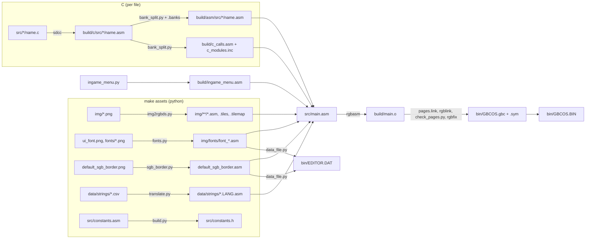
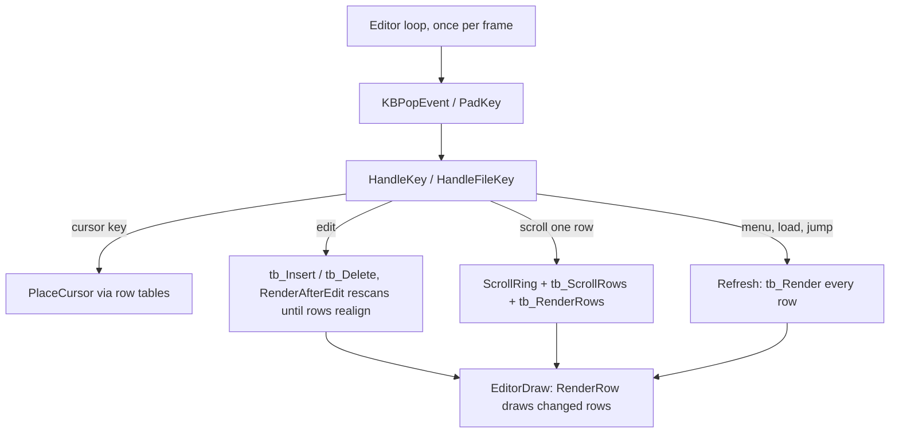
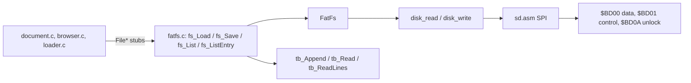

# Architecture

FatPak is a Game Boy text editor and game launcher built as a single 128 KiB
EverDrive GB X7 OS image for DMG, CGB and SGB: SD file editing, PS/2 input,
styled text, stock-compatible saves, RTC, save states and Game Genie codes.

See also [README](../README.md) (controls, building), [TODO](TODO.md),
[EverDrive compatibility](EVERDRIVE.md) (file formats, launch) and
[In-game menu](GAME_MENU.md) (capture/restore). Paths are relative to the repo root.

## Toolchain

| Tool | Used for |
| --- | --- |
| [RGBDS](https://rgbds.gbdev.io/) 1.0 | `rgbasm`, `rgblink`, `rgbfix` |
| [SDCC](https://sdcc.sourceforge.net/) 4.2 (`-msm83 --asm=rgbds`) | C to RGBDS assembly |
| Python 3 + Pillow | Asset conversion, page splitting, layout checks |
| [Gearboy](https://github.com/Q-Bert-Reynolds/Gearboy) fork | EverDrive mapping, SD, RTC, cart button and PS/2 emulation; MCP debugging |

**Assembly** for hardware, hot paths and heavy lifting (drawing, input, memory,
text buffer, SPI); **C** for higher-level logic (editor state, menus, file API).
FatFs is C as a third-party library.

## Building

- **One assembly unit.** `src/main.asm` includes `src/fatpak.inc`, which lists
  every subsystem and `build/c_modules.inc`. C files compile independently (FatFs
  is the one amalgamation). `pages.link` places resident code and page fragments;
  `check_pages.py` verifies and prints page usage.
- **Generated assets are committed** (`img/**/*.asm`, `*.tiles`,
  `data/strings/*.asm`, `src/constants.h`, the ROM); generated C assembly lives
  only in `build/`.
- **Targets:** `all` (clean, assets, assemble, run), `assemble`, `code`
  (assemble + run), `assets`, `run`, `clean`.
- **`LANGUAGE=EN|ES|FR|IT|PT|DE|JA`** picks the generated string include. Editor,
  clock and cart-menu labels are still hard-coded English.
- **Install:** if `/media/qbertreynolds/GAMEBOY` is mounted, `make assemble`
  copies `GBCOS.BIN` and `EDITOR.DAT` to `GBCSYS/`. Keep them in sync (data
  version 5).
- **Shared constants:** `build.py` turns `DEF X EQU ...` in `src/constants.asm`
  into `#define`s in `src/constants.h`. Parenthesize expressions.

## Source layout

| Path | Contents |
| --- | --- |
| `src/main.asm`, `fatpak.inc` | Header, boot; includes every module (order matters) |
| `src/app/` | Startup (`main.c`), menus/shortcuts (`menu.c`), `Choose` and dialogs (`dialogs.c`) |
| `src/editor/` | Edit loop, documents, navigation, large-file window, view/bars, help, filename prompt, OSK, text buffer, keywords, undo |
| `src/browser/` | Folder browser (`browser.c`), file-info host (`info.c`), UTF-8/path helpers (`paths.c`) |
| `src/ui/` | Layout, renderer, boxes, text formatting, footer clock, frame waits, theme/color, SGB, fades, icon escapes |
| `src/game/` | Loader UI (`loader.c`), loading display (`loading.asm`), launch (`launch.asm`), cart menu (`ingame.asm`), snapshots (`snapshot.asm`) |
| `src/fatfs/` | FatFs (`lib/`), SD/SPI (`sd.asm`), file API and game-file formats (`fatfs.c`) |
| `src/keyboard/` | PS/2 and iGKB drivers, keyboard-test host (`test.c`) |
| `src/rtc/` | Calendar I2C, clock-dialog host, date validation, FAT timestamps, game RTC |
| `src/modules/`, `modules/` | Overlay loader and module ABI wrappers; module sources and `abi.json` ([MODULES.md](MODULES.md)) |
| `src/core.asm`, `gbdk.asm`, `memory1.asm`, `math.asm`, `strings.asm`, `far_call.asm` | Trampoline, VBlank waits, tile/sprite/memory copies, math, strings, `FarCall` |
| `src/input.*`, `interrupts.asm` | Joypad/keyboard input and repeat, interrupt vectors |
| `src/charmap.asm`, `constants.asm`, `macros.asm`, `hardware.inc`, `wram.asm`, `sram.asm` | Charmap, constants, macros, registers, RAM layout |
| `scripts/` | Python build tools: asset converters, `build.py` (constants header), `bank_split.py`, `module_build.py`, page/ABI checkers, `data_file.py`; run from the repo root (the Makefile does) |
| `tests/` | Python bank-split/glyph checks; Gearboy-driven `run_*.sh` integration tests |
| `img/`, `data/`, `sd/` | Graphics, fonts, strings, help text; sample SD contents |

## Boot

`Main` (cold) and `WarmMain` (return from a game) in `src/main.asm`:

1. Set OS mapping, reset cart-switch state, restore the editor VBlank vector.
   Cold boot only: configure the factory feature mask and mapper RTC controls
   ([EverDrive](EVERDRIVE.md#clock-and-rtc)).
2. Clear HRAM; detect CGB by the VBK write/read probe (no boot-ROM register
   reliance, so it works after a warm return). Pocket/GBA aren't distinguished.
3. Outside CGB, `MLT_REQ` probe sets `SYS_INFO_SGB`; set SGB palettes. Copy the
   OAM DMA routine to HRAM.
4. CGB: double speed, `DefaultPalettes`.
5. Clear WRAM, pick CPU tile copies (warm) or HDMA (cold CGB), set the stack,
   silence sound, init drawing, interrupts and keyboard.
6. `_AppMain` (`src/app/main.c`) draws a header, clock footer and loading box
   with the resident VWF, then backs up the previous game's save, loads
   `EDITOR.DAT`, restores `EDITOR.SWP` if needed, runs `tb_Load`, and reads
   `SESSION.DAT` to reopen the document (only if the editor was open) or the
   last folder (root if missing). Then `Editor()`; it never returns.

`OS Info` (`$01F0-$01FF`) holds stock launch/init/return/snapshot flags and the
mapper-write byte backup. Cart RAM ownership comes from `EDITOR.GAM` and
`REGISTRY.BIN`, not these flags.

## Memory map

- **Resident image** `$0000-$7FFF`: always mapped and writable; mapper writes
  clobber a few bytes, which launch saves for warm return.
- **OS pages** `$A000-$BCFF`: 8 KB image fragment selected by `$BD08`, `$1D00`
  usable bytes; image pages 4-15. `$BD00-$BFFF` holds registers and the
  PSRAM/save window.
- **WRAM0:** 1 KB stack (FatFs needs depth), OAM buffer, shared vars, keyboard
  queues, text buffer and renderer vars, `_font_widths` (page aligned), most C
  globals. Large-file and game bookkeeping live in writable resident ROM
  (`fatfs.asm`).
- **WRAMX 1:** `tile_buffer`, `bkg_buffer` (19 blocks × 40), `win_buffer` (360 B,
  gap-move chunks), `tile_attrs`, lexer row states (the first 3,072 bytes, which
  a wide module borrows as its BSS while it runs), `cmd_buffer` (row bitmap,
  page aligned), `str_buffer`, `name_buffer`, `render_dma_buffer`.
- **HRAM:** `loaded_bank`, input, `pad_latch`, interrupt vars, OAM DMA routine,
  `vbl_done`, `sys_info`.

### PSRAM

`$BE00-$BFFF` shows the 512-byte block selected by `$BD03:$BD02` (battery save
RAM instead when `$BD06` bit 1 is set).

| Blocks | Editor use |
| --- | --- |
| `$0100-$017e` | Text gap buffer (127 blocks, 65,024 bytes) |
| `$0180-$01ef` | Undo ring (112 blocks, 56 KiB) |
| `$01f0-$01ff` | Settings/signatures and 7,936-byte clipboard |
| `$3d00-$3d54` | `EDITOR.DAT` v5 (85 blocks): header, fonts, SGB border, help, paired shift tables (77), VWF bold widths (84) |
| `$3d55-$3d64` | Filename prompt undo ring (64 states) |
| `$0400-$3cff` | Large-file add buffer (`ADD_MAX` = `$720000` bytes), bounded before protected assets |
| `$0400-$0bff`, `$0c00-$0fff` | While a text-buffer document is open: `ASM.MOD`'s ROM image (1 MiB) and symbol table ([ASSEMBLER.md](ASSEMBLER.md)) |
| `$3d80-$3dc5` | Module staging, page backups and the WRAMX backup ([MODULES.md](MODULES.md)) |

| Blocks | Game use |
| --- | --- |
| `$0000-$3bff` | Launched ROM (max 7.5 MiB) |
| `$3c00-$3ca3` | State-file staging for Load |
| `$3e2f` | Snapshot path and RAM-size metadata |
| `$3e3f` | Pre-rendered filename header (offset `$20`) |
| `$3e40-$3ee3` | Stock 82 KiB live snapshot |

The two overlap deliberately: launch saves editor state to SD first. PSRAM is
volatile; `EDITOR.SWP` keeps small-file text, settings and clipboard, but not
undo or unsaved large-file edits.

## Banking and calling conventions

- `loaded_bank` mirrors `$BD08`; `SET_BANK` updates both. Cart-menu capture and
  restore use resident page switchers while game HRAM is live.
- `TRAMPOLINE Label` far-calls from asm; arguments only in `a`, `de` and RAM.
- **SDCC `sdcccall(1)`:** arg 1 in `a`/`de`; arg 2 in `e` (if arg 1 was in `a`)
  else `a`/`bc`; the rest on the stack, callee pops. Returns `a`, `bc`, `debc`.
  `_tb_Insert::` is `tb_Insert()` in C.
- **Placement:** `.banks` files beside each `.c` assign functions to ROM0, FIXED
  or pages 4-15. `bank_split.py` resolves calls across all modules: same-page
  and resident calls stay direct; cross-page calls share one thunk per target in
  `build/c_calls.asm` (`FarCallInline` keeps stack args). Editing a `.banks` file
  re-places without recompiling. Private names get module prefixes. Asm entry
  points callable from C use `BANKED_C` stubs (register args only).
- **Space:** code must end below `$BD00` in every page, and every page is
  essentially full. Check `check_pages.py` output and `build/main.map` first.
- **C restrictions** (no SDCC libraries linked):
  - `_GSINIT` never runs: initialize globals in code (WRAM is zeroed).
  - `_mullong`/`_divulong` are in `src/fatfs/lib/runtime.c`; `memcpy`,
    `memset`, `memcmp`, `strchr` in `fatfs.asm`. Avoid 16-bit `*`/`/` elsewhere.
  - String literals go through the charmap (`"\n"` is 128); use `'\n'` (10).
- **SDCC pitfalls:** always build with the Makefile's
  `--no-peep --peep-file peephole.def` (plain output stores through a stale
  `hl`). SDCC also clobbered `hl` reading a `signed char` global (see
  `RenderAfterEdit`). When C misbehaves, read the generated asm.

## Interrupts and input

| Vector | Handler |
| --- | --- |
| VBlank | `VBLInterrupt`: OAM DMA, `LatchPad`, `vbl_done` |
| STAT | `LCDInterrupt` → `rLCDInterrupt` (`RenderLCDInterrupt` in the editor) |
| Serial | `SerialInterrupt`: PS/2 bits into the scan-code ring |

- **Joypad:** `UpdateInput` (from `WaitFrame`) reads buttons and processes queued
  scan codes. VBlank also latches new presses into `pad_latch`, read with
  `PadPressed()`, so presses aren't lost during multi-frame redraws.
- **PS/2:** the keyboard clocks bits into the link port; 11-bit frames go into a
  64-entry ring. `ProcessKeyCodes` decodes through `kb_jump_table.asm` per
  `kb_mode`: `KB_MODE_BUTTONS` (keys act as pad buttons), `KB_MODE_EDITOR`
  (key + modifier events for `KBPopEvent`, `KEY_*` codes), `KB_MODE_TYPING`
  (legacy, unused). No host-to-keyboard traffic, so no LEDs/caps lock.
  Detected at boot; KEYBOARD TEST calls `KBListen` later. In Gearboy, Caps Lock
  toggles the emulated keyboard.
- **iGKB** handlers exist; detection is disabled.

## Editor

`editor.c` holds init, edit/selection commands and the loop; `navigation.c`
cursor movement, `document.c` open/save, `window.c` large-file windows,
`view.c` cursor/selection/bars, `osk.c` + `osk.asm` the on-screen keyboard;
`editor/state.h` is the shared state. `HandleKey` sets one flag per frame:

| Flag | Meaning | Work |
| --- | --- | --- |
| `moved` | Cursor moved | `PlaceCursor` finds its row in `tb_row_starts`, moves the sprite |
| `edited` | One insert/delete | `RenderAfterEdit` rescans from the previous row until a row starts where it used to (± the edit) |
| `redraw` | Rows rescanned, text unchanged | `Draw`: selection, bars, `EditorDraw` |
| `dirty` | Anything else | `Refresh` renders every row and scrolls the cursor into view |

The status bar's line number is `LinesBefore(top)` plus the LF-ended rows above
the cursor. `LinesBefore` caches `counted_pos`, counting only new LFs with
`tb_CountLines`; small edits before it adjust it, big ones reset it.

Known-slow work shows a box first via `ShowBusy` ("Loading...", "Saving...").
Help, browser, messages and prompts write `tile_buffer` rows directly and call
`EditorDraw`; keyboard test uses `BeginFullScreen` without bars.

### Text buffer (`src/editor/text_buffer.asm`)

Gap buffer in PSRAM `$0100-$017e` via the window. Positions are logical (gap
excluded); physical offsets map to block + window offset.

- **Gap is zeroed and text never contains 0**, so `tb_Load` recovers the layout
  (text, zeros, text). `TXT3` marks a valid buffer; boot restores the swap
  otherwise. `TBMoveGap` copies ≤256-byte runs through `win_buffer` and zeroes
  what it leaves; the gap only moves on edits away from it.
- **Lexing** (`TBLex`): `TBScanRow` calls the lexer per character, which returns
  `tb_attr` (low nibble width, high nibble style: `STYLE_TEXT`, `STYLE_BOLD`,
  `STYLE_MARK`, `STYLE_CODE`, `STYLE_HEAD`..., looks in `StyleLooks`) and
  `tb_next_state` (committed by `TBCommit`). `TBDrawChar` stores the attr in
  `tile_attrs`; all width measurement (`RenderCursorX`, `PosAtX`, selection,
  drawing) reads from there. `SetLang` picks the lexer by extension (`.md`,
  `.c/.h`, `.asm/.inc/.s`, else plain). A 2-byte state is saved per row in
  `tb_row_states`; wrapped words return to the state after the last space;
  rendering from an unknown state scans from the line start (`TBSyncState`).
- **Markdown:** `#`×1-6 + space is a heading (`TBPeekHeading`; level kept in row
  state; H1-H4 drawn in `FONT_H1`-`FONT_H4`). `**` toggles bold; lone `*`/`_`
  opens italic before a non-space when not inside a word, closes after a
  non-space when no word follows; `` ` `` toggles code. Markers are dim
  `STYLE_MARK`.
- **C/asm** (`TBLexCode`): state holds token mode (word, string, char, line/block
  comment) and the word's style, decided at its first char by `TBPeekWord` +
  `KeywordLookup` (tables generated by `keywords.py`: 32 buckets by
  `first char & 31`). Handles `//`, `/*`, asm `$`/`%` numbers, C `#` directives
  and asm labels at column 0. Multi-line state (C block comments, markdown
  fences) comes from `TBLineState`: checkpoints every 1 KB (`tb_checks`,
  invalidated by `TBEdited`), scanning forward with `TBCheckRun`/`TBCheckRunMD`.
  Those scanners must agree with `TBLexCode`/`TBLexMD`.
- **Rows** (`TBScanRow`): ≤160 px and ≤40 chars; end after LF, wrap after the
  last space, trailing spaces/LF may hang. Control chars draw as spaces. With wrap
  off (`tb_nowrap`, Alt+Z) a row is a whole line offset by `tb_left`; `ScrollX`
  (view.c) adjusts it, keeping 40 px left of the cursor scrolling right and 120
  px scrolling left.
- **Row tables:** `tb_row_starts`, `tb_row_counts`, `tb_end_row` drive cursor
  movement, partial renders and scrolling without rescanning PSRAM.
  `tb_Render`/`tb_RenderRows`/`tb_ScrollRows` fill `tile_buffer` (18 rows ×
  `TB_STRIDE` 40).
- **Settings** (`src/sram.asm`): `SettingsTable` (`tb_nowrap`, `bars_on`,
  `fs_crlf`, `modified`, `file_dir`, `file_name`, `theme`) saved behind `SET3` in
  block `$01f0` whenever one changes. New settings go last: `SettingsLoad` still
  reads `SET2` (no theme) and defaults the theme to light.
- **Clipboard:** `tb_DeleteRange` grows the gap over a range; `tb_Copy`/`tb_Paste`
  move 256 bytes at a time through `win_buffer`. Selection is `anchor`..`cursor`.
- **Undo** (`undo.c` + `undo.asm`): ring of records (header, text, trailing
  length for walking back) in `$0180-$01ef`; `undo_head`/`undo_top` for redo;
  oldest dropped when full. Typing a word or holding delete/backspace merges
  until the cursor moves; typing/pasting over a selection joins its delete.
  `undo_saved` clears `modified` when undone back to the save point. Not kept
  across power-off.

### Rendering (`src/ui/render.asm`)

Text is drawn as pixels so fonts can be any width. Every cell has its own tile
(360), but the BG addresses 256 at once:

- **Tile blocks:** each row is a 20-tile block. DMG/SGB: blocks 0-5 need `$8000`
  addressing, 9-14 `$8800`, 6-8 and 15-17 work in both; tiles 0-1 are the cursor
  and OSK highlight sprites. GBC: all blocks are `$8800` tiles split over both
  VRAM banks via attributes, giving a 19th block and no mode switches.
- **Layout** (`ui/screen.c`): fills `render_row_blocks`/`_lines`/`_fonts`. Text
  rows ring through the BG map from `ring_top`/`ring_pos`. The filename bar
  (`tile_buffer` row 18, block 8), OSK (blocks 9-13) and status bar (row 19, block
  17) live in the window, stacked from window row 0, so they don't scroll. Bars
  draw fully selected. `render_text_top` is text row 0's screen row.
- **LCDC events:** `RenderStage` builds per-frame `render_events` (LY, tile mode,
  window bit); `RenderLCDInterrupt` fires the line before and writes LCDC in
  HBlank. Tile-mode switches land mid-band of shared blocks to tolerate late
  interrupts. The window is re-enabled below the text and continues from its
  next internal line; without bars WY is the first bottom row instead.
- **Scrolling** rotates the ring one block: the departing block draws the new
  row, SCY moves 8 px, `Layout` re-points the changed map row. SCY/WY/LCDC
  changes apply together at line 144; `EditorDraw` waits for that before drawing.
  DMG scrolls whole rows only.
- **Smooth scrolling (GBC):** one spare ring block takes the incoming row
  off-screen; the line-144 handler then moves SCY 2 px/frame to
  `render_target_scy`. `render_pending` 2 → draw row → 1 → scroll starts. Jumps
  and layout changes move SCY at once.
- **Row cache:** `bkg_buffer`, `row_font` and `block_states` let `RenderRow` skip
  unchanged rows.
- **Drawing:** glyphs are ORed into a 160×8 1bpp bitmap via seven paired
  512-byte right/left shift tables in `EDITOR.DAT`, plus `render_dim` for dim styles and, on GBC, `render_accent`
  (`win_buffer`) for accents. `RenderEncode` builds 2bpp tiles in
  `render_dma_buffer`: ink 3, dim 2, accent 1 on paper 0. DMG inverts selected
  pixels; SGB/GBC highlight them (color 1, accent ink → 3). Uploads: DMG copies
  two bytes per atomic STAT check; GBC uses HDMA (`RenderRowDMA`, finish with
  `RenderWaitDMA` before the next row or map write) or the same CPU loop when
  `render_cpu_copy` is set (game loading, after warm return).
- **GBC palettes:** tiles with accent ink use palettes 1-4, selected tiles 0
  (`RenderSetPalettes`/`RenderWritePalettes`). `block_map_rows` tracks each
  block's map row so accented blocks are rewritten when they move.
  `EditorSetPalettes`: paper, highlight, dim, ink; accents blue (headings), dark
  red (code), purple, brown-orange.
- **Theme** (`src/ui/theme.asm`, `THEME_PAGE` 6): `theme` picks light or dark.
  `ThemeApply` (resident) reloads every palette: GBC BG palettes 0-4 and OBJ
  palette 0 (cursor, keyboard highlight) from `LightPalettes`/`DarkPalettes`;
  SGB the same colours through `PAL01`; DMG inverts `BGP` and `OBP0` (`$1B`) and
  `EditorInvertCursor` flips the cursor's shade, remembering its last argument in
  `cursor_white`. Startup applies it after each settings load. The in-game menu
  isn't themed.
- **Selection:** `render_sel` holds each row's selected column range; changed
  rows redraw. DMG shows colors 1/2 inverted, GBC/SGB as blue. OBP1 turns the
  cursor white at a selection start.
- **Menu box:** `render_box_*` (x, width, `BOX_STRIDE` text in `tile_buffer`
  rows 20+, highlight). `RenderBox` clears and draws over covered rows with
  half-row top/bottom borders. `RenderBoxSig` (with `render_box_gen`) limits
  redraws to covered rows. `RenderTextWidth` sizes `Choose` boxes.
- **Cursor:** sprite 0, 1 px wide, x from `RenderCursorX`. Glyphs include a
  trailing 1 px gap, so rows (except the 8 px font) are shifted right 1 px and
  the cursor sits in the gap.

### Fonts and icons

`scripts/fonts.py` ([FONTS.md](FONTS.md) has the image conventions) converts `img/ui_font.png` (8 px mono), `img/fonts/fixed_font.png`
(4 px) and `img/fonts/vwf_font.png`, and derives/converts the heading, bold,
italic and bold-italic fonts (widths in `styled_widths.asm`). Plain text and
markdown use the VWF; C/asm use the 4 px font. OSK rows use the 8 px font; bars
and help the VWF. No font picker yet.

`EDITOR.DAT` holds the styled glyphs, fixed and mono glyphs, SGB border,
help, paired shifts and VWF bold widths; renderers (`RenderStyleGlyph`, `RenderFixedGlyph`) read them through the
window and restore the previous block. Without the file, rendering falls back to
resident VWF glyphs with fixed spacing where needed. Base VWF widths remain
resident; bold widths come from the data file and headings/code use constant
width IDs. Without external data, shifts are computed and bold uses base widths.

Button icons are codes 1-8 in `ui_font.png` (129-131 are composed D-pad
glyphs), copied into both the VWF (9 px advance) and mono font. They keep their
four shades: an occupancy glyph plus two shading masks stored in VWF slots
132-153, composited by `RenderIcon` into the ink/dim/accent planes. `ui/icons.h`
and the `<BTN_*>` charmap entries name them; `data_file.py` expands those in
help. The footer clock marker is `$7F`.

### On-screen keyboard (`src/editor/osk.asm`)

Five rows of ten keys in the bottom `tile_buffer` rows: lowercase, one-shot
shift, caps lock and symbols layers; the last row has shift, symbols, menu,
space, undo, redo and return. Sprite 1, behind the BG, highlights the key.
Shift works like a phone keyboard (`PressShift` in `osk.c`): a tap shifts one
key, a second tap within 30 frames locks caps (⇪, mono font code 25), another
tap releases. Layer changes call `EditorDraw` directly, so modal prompts that
only draw after typing (`AskName`) still show them.

### Menus, browser and dialogs

`Choose` draws untitled menu boxes. Editor menu: FILE (open, save, save as,
new, build, run), EDIT, SETTINGS (line wrap, full screen, theme), HELP, CLOSE. Browser menu: FILE
(info, rename), EDIT (cut, copy, paste), SETTINGS (theme, clock, keyboard test), HELP,
RESTART (saves the swap, then `$BD06=$10` for a full cartridge reset through the
boot ROM). Select opens file info directly.

- **Help** (`editor/help.c` sets up the view, `HELP.MOD` draws): context-specific
  text from `data/help/*.txt`, packed as 32-byte rows. `BeginView(1)` keeps the
  header/footer; `ScrollRows` reuses the display ring and reads only the
  incoming record per step.
- **Build, Run** (`editor/build.c`, F7 and F5): `ASM.MOD` assembles the `.asm`
  document to `<name>.gb` beside it; RUN then `LaunchGame`s it. Results show in
  a box (`ShowBox`); errors name the file and line and move the cursor ([ASSEMBLER.md](ASSEMBLER.md)).
- **File menu:** OPEN (same as A), OPEN AS (TEXT, HEX or TILES: `ShowFileView`'s mode
  overrides the extension and NUL checks), INFO, RENAME, DELETE (asks first; `FileDelete`
  removes a file or an empty folder, refuses the open large document's file).
- **Info** (`browser/info.c` reads, `FILEINFO.MOD` draws): FAT dates/times
  (zero shows `--`), size in B/KB/MB. `FileInspect` uses a private `FIL` (an open large document survives):
  text ≤32 KiB gets word and line counts, NULs mean binary; games read only the
  header (`$134-$14F`). It borrows the directory-mark buffer, so the browser
  reloads on exit. A on the page opens the file (`InfoContext.open`).
- **File views** (`browser/viewer.c` opens the file in `save_file`; `ModRead` seeks and
  reads it). A file whose first sector has a NUL opens in `HEXVIEW.MOD`: read only, 8
  bytes a row in hex and characters, in `FONT_FIXED` with `render_text` set so
  `ModStyle` can dim the non-printing bytes. A `.tiles` file opens in `TILEVIEW.MOD`,
  whose rows are all raw 2bpp (`ModTiles` → `RenderRawRow`, after `EditorDraw` so the
  row cache keeps them): the tile 8x, 2x and 1x, and a sheet of tiles. The host calls
  `EditorRedraw` after, and the browser lists its folder again (the reads used `buffer`).
- **Rename** (`editor/name.c`, shared with filename prompts): edits the list row
  above the OSK, with its own 64-state undo ring at `$3d55-$3d64`.
- **File clipboard:** session-only, separate from text. Move = FatFs rename; copy
  walks whole trees (hidden and empty folders included), never overwrites, and
  removes an incomplete file on failure. Moves fix up the open document's path.

## SD card and files

- **Registers** respond after `$A5` → `$BD0A`. The sibling EverDrive disassembly
  is the reference for the stock interface.
- **`sd.asm`:** SD v1/v2/SDHC init and 512-byte sectors. Normal IO is busy-polled
  single-sector; ROM loading streams consecutive clusters with `sd_ReadBlocks`
  ([details](EVERDRIVE.md#rom-transfer-lessons)).
- **FatFs R0.16:** UTF-8 LFN (64 chars), CP437 SFN, `FF_FS_TINY=1`,
  `FF_FS_MINIMIZE=0`, timestamps from the calendar. `clst2sect` shifts instead of
  multiplying.
- **Mounting:** a failed sector IO clears `disk_ready` so FatFs remounts; list,
  load and save retry once after `FR_DISK_ERR`. A swapped card fails its first
  command and is remounted before any write.
- **Load/save:** `tb_Append` drops NULs and CRs (setting `fs_crlf`);
  `tb_ReadLines` restores CRs on save.
- **Listing:** `fs_List` walks directory slots once without decoding names
  (skipping hidden, system and dot entries), counting folders/files and marking
  every 16th slot in the 512-byte load buffer (spacing doubles past 128 marks).
  `fs_ListEntry` seeks from the nearest mark; `GetName` decodes LFNs, falling back
  to `get_fileinfo` for non-BMP or high-byte SFNs.
- **Browser** (`browser.c`): folders then files, `..` below root. Names aren't
  cached: visible rows are re-read on jumps, one row on scroll (same ring as
  text). Going up reselects the folder by name. Text opens via `LoadDocument`,
  ROMs via `LaunchGame`. `file_dir`/`file_name` are UTF-8, shown as Latin-1.
- **Gearboy:** "EverDrive X SD Card" (`GEARBOY_EVERDRIVE=0` disables).
  `VirtualFat` exposes a host folder (`GEARBOY_SD_DIR`, default home) as FAT32,
  writing changes back; `GEARBOY_SD_IMAGE` uses an image instead.

### Large files, swap and session

Files bigger than the gap buffer edit through a 48 KiB window (`WIN_SIZE`). A
96-entry piece table in page 14 references the file or the PSRAM add buffer.
`Slide` (`window.c`) commits and reloads when the cursor nears an inner edge;
`fs_ScanStep` counts lines in the background. `fs_SaveLarge` writes
`~EDITOR.TMP`, replaces the original and reopens it. The piece table isn't
persisted.

`/GBCSYS/EDITOR.SWP` holds small-file text, settings and clipboard. A valid
`TXT3` PSRAM buffer wins over the swap after reset. Large files clear `TXT3` and
stop swap updates, so boot reopens them from SD.

`/GBCSYS/SESSION.DAT`: tag (`$A0` browser, `$A1` editor), 128-byte folder,
65-byte filename. Written on folder change, entering the editor, new and save,
through a private `FIL`. Cached unsaved text is restored only when the session
names the same file; otherwise the file reloads from SD.

## Games

`LaunchGame` (`game/loader.c`) saves the swap, then `FileGameOpen` (backs up the
previous game's save first), chunked `FileGameCopy` with progress, and
`FileGameFinish` (SRAM, RTC, state, cheats, registry, GAM3). `_GameLaunch`
configures the mapper, installs the cart-menu vector and does the stock handoff.
See [EverDrive](EVERDRIVE.md) for formats, launch and transfer constraints, and
[In-game menu](GAME_MENU.md) for capture, restore and warm return.

The clock dialog is `CLOCK.MOD`; `rtc/menu.c` only runs it. Menu box text uses
`BOX_STRIDE` rows. A far call keeps the caller's page, but a page-local string
pointer passed to code on another page reads garbage (the same reason module
strings are marshaled).

## Testing and debugging

- `python3 -m unittest discover -s tests -v`: bank splitting, private names,
  button glyphs. `python3 tests/test_modules.py`: module packer and imports.
- `bash tests/run_*.sh` (prebuilt sibling Gearboy core, temporary SD folders,
  DMG and CGB): browser menus, file ops, info and clock modules; footer clock;
  in-game return; loading; session restore; module loader; BUILD/RUN with the
  assembler (`run_build.sh`, which first runs `tests/test_asm.py`, the PC
  comparison against RGBDS).
- `make -C ../Gearboy/tests everdrive` runs Gearboy's EverDrive component tests.
- Gearboy over MCP (`--mcp-stdio`/`--mcp-http`, `--headless`) has a per-function
  cycle profiler.
- Renderer/text-buffer changes: compare incremental updates with a full redraw
  (open and cancel a menu), diff saved files byte for byte, `fsck.fat -n` images.

## Conventions

- Terse asm: short `;` comments, routine headers listing register args/results
  (`;de = pos, returns char in a`), `.local` labels, public routine list at the
  top of each module. Each module includes `src/fatpak.inc` first.
- C-visible asm labels start with `_`; their prototypes go in the module's header
  (`text_buffer.h`, `render.h`, `loader.h`).

## Memory headroom and loadable modules

The non-EverDrive normalization/detection paths, register-hole branches, empty
SRAM enable macros, obsolete keyboard typing/demo support and unreferenced
arithmetic helpers have been removed.
VWF bold widths and 3,584 bytes of shift tables now live in `EDITOR.DAT` v5.
The resident VWF glyphs/base widths remain available before SD loading and in
the game menu; rendering computes shifts when external data is unavailable.
Table lookups preserve the selected PSRAM block, including during text reads.

Assets and filename undo moved above ROM loading and snapshot staging so game
progress cannot overwrite live shift tables. The large-document add limit now
stops before this reservation. Keep the OS and data file versions together.
With the keyboard test, clock dialog, file info, help and theme in modules, and
the assembler a two-page module, the map has ~1 KiB free in ROM0, ~3 KiB in
resident bank 1, ~0.7 KiB in page 6 and 6 bytes in WRAM0; the other pages are
95-100% full. See [MODULES.md](MODULES.md).
