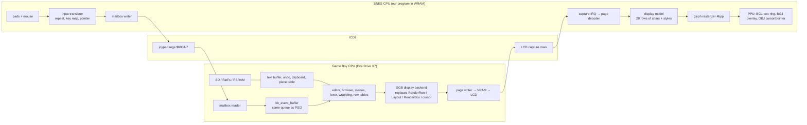
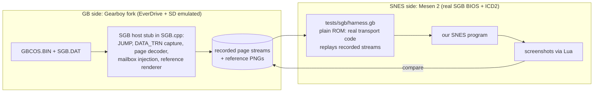

# Super Game Boy fullscreen mode (plan)

Status: **Phase 0a passed on hardware; Phases 0b/0c and the Phase 1 protocol
pass in Mesen/unit tests. Phase 0d budgets are recorded below.** The fullscreen
OS remains planned; additional hardware results are marked explicitly. **(verify)** marks documented hardware facts
(fullsnes, Pan Docs) that Phase 0 must confirm. The existing SNES mouse bridge
uses `DATA_SND` and a BIOS hook while leaving the GB picture visible; it is
separate from the fullscreen takeover tested here.

Today's SGB mode (DMG renderer plus `src/ui/sgb.asm`: `MLT_REQ` detection,
palettes, border from `EDITOR.DAT`, LCD VRAM transfers) stays as the **fallback**.

The current border uploader preserves `$8800-$9FFF` in snapshot staging
(`$3C00-$3C0B`, twelve PSRAM blocks) during startup. Interrupts stay masked while
the LCD displays the transfer payload; the original tiles, maps, scroll registers
and LCDC are restored before the screen is unmasked. The staging blocks are free
at this point, after the save backup and before any module or snapshot operation.
`gbdk_DisplayOff` waits for VBlank before disabling the LCD, as required by
[Pan Docs](https://gbdev.io/pandocs/LCDC.html#lcdc7--lcd-enable).

## Goals

- On an SGB, the editor, browser, menus and dialogs fill the 256x224 SNES screen.
  The SGB border and the 160x144 GB picture are not shown.
- Syntax highlighting and UI colors use the GBC palette values and style rules
  (`StyleLooks`, `EditorSetPalettes`). Color is per pixel instead of per 8x8 tile,
  so the GBC version's tile-grid limits don't apply.
- Every SNES pad button is used, with auto-repeat. Player 2's pad also works.
- The SNES Mouse (Mario Paint mouse) works in either port: pointer, click to place
  the cursor, drag to select, right-click for the menu, and clicks in the menus,
  browser and on-screen keyboard.
- Game launch, the cart-button menu and return to OS keep working, and launched
  games get normal SGB features (border, palettes).
- If any step fails (no `SGB.DAT`, upload error, no response from the SNES), the
  app falls back to the current SGB mode without losing data.

Non-goals for the first version: 512-pixel hi-res mode, SNES-side audio, SGB
fullscreen inside the cart-button menu (that menu stays GB-rendered under the
SGB BIOS).

## How the SGB works, and the mechanism this depends on

The SGB is a SNES cartridge containing a GB CPU/PPU and the **ICD2** chip. The SGB
BIOS (SNES code in the cartridge ROM) normally copies the GB's picture to the SNES
screen and interprets command packets. The `JUMP` command (`$12`) makes the BIOS
jump to SNES code that the GB uploaded into SNES WRAM. From then on **our SNES
program owns the SNES**: the PPU, both controller ports and the ICD2. *Space
Invaders* (1994) shipped this way.

The ICD2 is the only connection between the two CPUs. As seen from the SNES
**(verify every register on hardware)**:

| ICD2 register (SNES side) | Direction | Use in this design |
| --- | --- | --- |
| `$6000` (read) | GB → SNES | The LCD character row being captured (bits 7-3) and the current write buffer (bits 1-0) |
| `$6001` (write) / `$7800` (read) | GB → SNES | Select one of 4 row buffers, then read its 320 bytes (20 tiles × 16 bytes, SNES 2bpp format, which is byte-identical to GB 2bpp tiles when `BGP=$E4`) |
| `$6002` / `$7000-$700F` (read) | GB → SNES | Packet-ready flag and the last 16-byte packet the GB bit-banged on P1 |
| `$6003` (write) | control | GB reset (bit 7), player count for multiplayer (bits 5-4), GB clock divider (bits 1-0, SGB1) |
| `$6004-$6007` (write) | SNES → GB | The 4 "joypad" bytes the GB reads from P1, one per player ID |

That gives three channels:

1. **LCD capture (GB → SNES, bulk).** Whatever the GB displays arrives at the SNES as
   2bpp tile data. This is how `*_TRN` commands move 4 KB at a time. With our own
   SNES code we can capture data every frame. This is the main data path.
2. **Packets (GB → SNES, small).** 16 bytes per bit-banged packet. These are slow
   and only one packet is buffered. They are used for the BIOS-level bootstrap
   (`DATA_TRN`, `JUMP`), not after.
3. **Joypad registers (SNES → GB).** In 4-player mode the GB reads 4 bytes by
   cycling P1. This is the only path back to the GB, so it is a **mailbox**.

## The split: what runs where

Core decision: **the GB keeps all editor logic and becomes a "terminal client".
The SNES becomes a display and input server.** The SNES does not know about files,
the text buffer, wrapping or the lexer. It draws what the GB says and reports what
the user does.

Why not move the editor to the SNES: the text buffer, undo, clipboard, piece table
and swap file are built on PSRAM and FatFs, which only the GB can reach. A 65816
rewrite would duplicate about 20K lines and still need a slow file channel for
every edit. The terminal split keeps most existing code and replaces only the
pixel output and the input source.



| Concern | Game Boy | SNES |
| --- | --- | --- |
| SD card, FatFs, file browser listing, saves, RTC, game launch | ✔ | |
| Text buffer, undo, clipboard, large-file windows, swap file | ✔ | |
| Lexing / syntax styles (`TBLex`), wrapping (`TBScanRow`), row tables | ✔ | |
| Cursor position logic, selection logic, `PosAtX` hit testing | ✔ | |
| Menu/dialog/OSK **content and logic** (`Choose`, `osk.c`) | ✔ | |
| Fonts (glyph bitmaps + widths) | widths only (for layout) | glyphs + widths |
| Glyph rasterizing, colors, palettes, VRAM, scrolling | | ✔ |
| Menu box, bars, OSK **drawing** (overlay layer) | | ✔ |
| Text cursor sprite, mouse pointer | position/state | ✔ drawing |
| Reading pads and mouse, key repeat, button → key translation | | ✔ |
| Pointer movement, acceleration, clamping | | ✔ |
| Launch/reset handshake | arms cart after acknowledgement | displays reset instruction |

Hit testing is split as well. The SNES sends the pointer as **(screen row, pixel x)**
and the GB resolves it with the data it already has: `PosAtX` for text rows, the
box geometry for menus, row kinds in the browser and key positions in the OSK.
The SNES never needs the editor's layout.

## Wire protocol

The canonical v1 constants are in `src/sgb/protocol.asm`. `make sgb-protocol`
generates `src/sgb/protocol.h`, `snes/protocol.inc` and
`tests/sgb/protocol.hpp`. The complete wire tables, CRC, publication ordering,
sequences, recovery limits and SGB.DAT layout are in
[the Phase 1 specification](SGB_PROTOCOL.md). The following is a design overview;
that specification governs the exact encodings.

### GB → SNES: double-buffered LCD pages

The GB keeps the LCD on with `BGP=$E4` and a **fixed** BG map that never changes in
fullscreen mode:

| LCD char rows | Tiles | Content |
| --- | --- | --- |
| 0-5 | 0-119 | **Page A**: 1,920 bytes |
| 6-11 | 120-239 | **Page B**: 1,920 bytes |
| 12 | 240-255 | **Status row**: 16 tiles, heartbeat, busy flag, input-ack sequence and CRC. Written by the VBlank handler |
| 13-17 | blank tile | unused |

Phase 0b uses 16 status tiles. The last is blank, also used for the remaining
columns and rows. Unsigned tile addressing fits everything into `$8000-$8FFF`,
so fullscreen transport needs no LCDC raster switches.

Page format: `[seq][len lo][len hi][commands …][CRC16 lo][CRC16 hi]`. The GB writes the payload
and checksum first and the `seq` byte **last**. The SNES captures both pages every
frame and applies a page whose `seq` is newer than the last applied one and whose
checksum matches. A capture that tears while the GB is writing fails the checksum
and is retried on the next frame. The GB only refills a page after the mailbox
acknowledges that page's `seq`, which provides flow control. The map never
changes, so there are no map writes and no mid-frame LCDC changes.

Measured baseline: the Phase 0b STAT-safe two-byte writer waits for modes 0/1
and fits its stores into the following mode 2 if necessary, without HDMA. In
Mesen it peaks at **641 bytes per GB frame**, averaging about **482 bytes per
active writing frame**. This includes instrumentation; it is below the earlier
1–1.5 KB estimate. Faster copying and CRC cost must be measured in the backend.

Commands (overview; exact v1 payloads are in the linked specification):

| Command | Payload | Notes |
| --- | --- | --- |
| `ROW` | screen row, font, flags, sel start/end, n, chars[n], styles RLE | Most traffic. Style bytes are `tile_attrs` (width low nibble, style high nibble) and are mostly runs, so RLE roughly halves them |
| `ROW_SAME` | screen row, source row | Repeats a row the SNES already has (after scrolls) |
| `SCROLL` | ±rows, smooth flag | The SNES rotates its BG1 ring and animates VOFS |
| `LAYOUT` | text top, text rows, bars on/off, OSK rows | Mirrors `Layout` |
| `CURSOR` | row, pixel x, look (normal/white/hidden) | The GB already computes `RenderCursorX` |
| `BOX` / `BOX_LINE` / `BOX_HI` | x, width, rows / line text / highlighted line | Menu boxes on the overlay layer. Closing a menu does not redraw text |
| `BAR` | top or bottom, text | Title and status bars on the overlay layer |
| `OSK` | layer, selected key | The SNES draws the 5×10 keyboard from a key table it already has |
| `PALETTE` | index, 15-bit colors | GBC colors are already BGR555, the SNES format |
| `BUSY`, `PROGRESS` | on/off, loaded/total KB | Loading box |
| `LAUNCH` | RESET_REQUIRED | The SNES acknowledges, then displays the reset instruction (see Game launch) |
| `HELLO` / `RESET` | protocol version | Handshake and full redraw |

Big data never goes through a separate queue. The page writer serializes **dirty
rows straight from `tile_buffer`/`tile_attrs`** into VRAM. Only small control
commands use a short WRAM queue (64 bytes). The current baseline has only **1
byte free in WRAM0 and 33 bytes in WRAMX**; the queue requires reclaimed memory,
not an additional resident allocation. Phase 0d must budget it explicitly.

### SNES → GB: the mailbox

The SNES sets the ICD2 to 4-player mode and writes 4 bytes. The GB reads all 4
(8 nibble reads plus ID advances, about 200 cycles) once per frame in
`UpdateInput`.

- byte 0: event sequence 1–127 with bit 7 busy. The writer marks busy before
  updating bytes 1–3, then commits; the GB accepts only equal, nonbusy before/after reads
- byte 1: event type
- bytes 2-3: payload

| Event | Payload | GB action |
| --- | --- | --- |
| `KEY` | key code, modifiers | Pushed into `kb_event_buffer` exactly like a PS/2 key (`KEY_*` codes from `constants.asm`) |
| `MOUSE_DOWN` / `MOUSE_DRAG` / `MOUSE_UP` / `MOUSE_MOVE` | screen row (5 bits) + button, pixel x | New mouse handler (below) |
| `HELLO` / `ACK` | protocol version / page seq | Handshake; page flow control also arrives this way |

The SNES keeps a ring of pending events and advances when the GB's status row
echoes the consumed sequence. That is about 60 events/s. It is enough because the
SNES coalesces pointer motion and generates key repeat itself.

## SNES program (`snes/`, 65816, ca65)

Runs from SNES WRAM. The direct page and stack go in bank `$00` (`$7E` low mirror);
code and fonts go wherever the BIOS's working memory is not, likely bank `$7F`
**(verify in Mesen's memory viewer before choosing load addresses)**.

| Module | Job |
| --- | --- |
| `boot.s` | Entry from `JUMP`: mask interrupts, set our own NMI/IRQ, PPU init (mode 1), clear VRAM, load palettes, send `HELLO` |
| `icd2.s` | Capture: an H/V-IRQ re-armed about every 16 scanlines (about 1 ms) polls `$6000` and DMAs each finished row buffer from `$7800` (320 bytes, about 0.12 ms) into a WRAM page image. It must keep up with 4 row buffers, so the maximum latency is about 3.6 ms. Also the mailbox writer to `$6004-$6007` |
| `proto.s` | Page validation (seq/checksum), command dispatch into the display model |
| `model.s` | 28 rows × (64 chars, 64 styles, font, selection, flags, dirty bit); cursor; overlay state |
| `raster.s` | Dirty row → 256×8 4bpp row (1 KB) in WRAM: OR 1bpp glyph rows at a pixel x, with ink by style. Same algorithm and same font data as `RenderGlyph`/`RenderEncode` |
| `ppu.s` | NMI: DMA queue of finished rows to VRAM (about 4-5 KB per VBlank), BG1 VOFS/ring, OAM, palette changes |
| `overlay.s` | BG3 2bpp: bars, menu box, OSK, dialogs |
| `input.s` | Auto-joypad read of ports 1/2, mouse detection by signature, serial read of the mouse's motion bytes, sensitivity, pointer integration/acceleration, key repeat, button → event translation |
| `debug.s` | L+R+Select overlay: protocol counters, checksum failures, seq numbers, mailbox state. This is the only diagnostic view on real hardware |

**Video layout (mode 1, 256×224, 28 rows of 8 px):**

| VRAM | Size | Use |
| --- | --- | --- |
| BG1 4bpp tiles | 32 KB | 32 columns × 32 rows of unique tiles: a **scroll ring** with 4 spare rows, so smooth scrolling works like the GBC version (2 px/frame or finer) |
| BG1 map | 2 KB | 32×32, rows rotate on scroll |
| BG3 2bpp tiles | 14 KB | Overlay: bars, menus, OSK. High priority (`BGMODE` bit 3) so it draws over BG1. Color 0 is transparent |
| BG3 map | 2 KB | |
| OBJ tiles | 2 KB | Text cursor, mouse pointer (two shapes) |
| Total | about 52 KB of 64 KB | |

**Colors.** BG1 uses one 16-color palette, so ink color is **per pixel**:
0 paper, 1 selection highlight, 2 dim ink, 3 ink, 4-7 accent inks (heading blue,
code dark red, purple, brown-orange; the same values as `EditorSetPalettes`), and
8-15 the same inks on the highlight, following the GBC rule that accent ink turns
to color 3 when selected. A `PALETTE` command can change them later for
themes and inverted mode.

**Geometry.** 256 px wide with an 8 px left margin leaves 248 px rows (the GB
version has 160). That is **62 columns** with the 4 px code font and about 55 with
the VWF. Rows are capped at 64 characters. There are 28 rows: 26 text rows with
both bars, and 21 with the OSK open.

**Speed estimate.** About 64 glyphs × 8 lines per row at about 40 cycles each is
about 20K cycles, or about 6 ms at 3.58 MHz. A full 28-row redraw takes about 10
frames, the same order as the GB doing a full redraw today, and single-row edits
and scrolls fit in one frame. If that's too slow, pre-shifted glyph tables (as
the GB renderer uses) are the first optimization.

**Fonts.** `fonts.py` already emits 1bpp rows and width tables. The SNES uses the
**same bytes**. Only the code that consumes them changes.

## Game Boy side (`src/sgb/`)

| Piece | Job |
| --- | --- |
| `sgb/boot.asm` | After `sgb_Init` detects an SGB: load and validate `/GBCSYS/SGB.DAT` into PSRAM next to `EDITOR.DAT`, upload the SNES blob with the Phase 0a DATA_TRN path (4 KB `DATA_TRN` chunks, about 12 chunks, about 1-2 s), send `JUMP`, wait for `HELLO` in the mailbox with a timeout. On success set `SYS_INFO_SGBFS`; on failure keep today's SGB mode |
| `sgb/transport.asm` | Page writer (STAT-safe VRAM copies, the DMG loop pattern), status row in VBlank, mailbox reader |
| `sgb/display.asm` | Backend that replaces `RenderRow`, `Layout`/`RenderStage`, `RenderBox`, `PlaceCursor`'s sprite write, `RenderSetPalettes`, `ShowBusy` and `ShowGameProgress` drawing. It turns them into protocol commands |
| `sgb/input.asm` | Mailbox events → `kb_event_buffer`; mouse events → `HandleMouse` |
| `editor/mouse.c` | **New, used by every mode:** click → `PosAtX(row, x)` sets the cursor; drag → anchor/cursor selection; right-click → menu; `Choose` row hit test; browser row select (second click opens); OSK key hit test; top bar → menu |

**Dispatch.** The render entry points start with a `sys_info` check and
`jp` to the SGB backend in fullscreen mode. Callers such as `editor.c` and
`browser.c` don't change. `RenderRow` already skips unchanged rows through
`bkg_buffer`. In fullscreen mode that cache becomes a 16-bit hash per row
(56 bytes), and a changed hash marks the row dirty for the page writer.

### Prerequisite refactor: screen geometry

The editor hard-codes the GB screen: `TB_ROWS 18`, `TB_STRIDE 40`, `TB_WIDTH 160`,
about 100 uses across 17 files (`text_buffer.asm`, `render.asm`, `screen.c`,
`browser.c`, `view.c`, `osk.asm`, `ingame.asm`, …). Fullscreen needs 28 rows of up
to 64 characters and 248 px.

- `tb_row_width` (px) and the row count become **runtime variables**. `TBScanRow`
  compares against a variable instead of an immediate, which costs a few cycles.
- The stride stays a compile-time constant (all indexing is `row * TB_STRIDE`).
  The plan: **stride 64 in fullscreen layout, 40 in GB layout**, selected by
  separate WRAMX `UNION`s, with indexing through a small row-address table
  (`RenderRowAddress` already exists) instead of multiplies.
- **WRAM budget (WRAMX, 4 KB):** fullscreen does not need `bkg_buffer` (760),
  `cmd_buffer` (512), `render_dma_buffer` (320), `block_states` or the GBC accent
  buffer. That frees about 1.6 KB on top of the 1.7 KB `tile_buffer` + `tile_attrs`
  already use. 26 text rows × 64 × 2 = 3.3 KB plus bar/box text just fits. If the
  measured budget doesn't fit, cap the stride at 56 (62 code columns becomes 56).
  **Phase 0d produces the real spreadsheet before Phase 2 starts.**

### ROM space

The current link map has 41 bytes free in ROM0 (fragmented), and every OS page
is 99-100% full. The GB-side SGB code (estimated 2.5-4 KB) can't be resident. Options, in
order of preference:

1. **Overlay.** The [TODO](../TODO.md#os-utilities) overlay design is built first as
   general infrastructure. On SGB fullscreen, the DMG/GBC renderer's drawing code
   is dead, and the SGB backend loads from `SGB.DAT` into a page at boot.
2. The renderer shift tables and VWF bold widths now live in `EDITOR.DAT`.
   Keep the base UI font/widths resident for boot and game-menu fallback.
3. Squeeze into the existing per-page gaps (fragile; last resort).

## Data file: `bin/SGB.DAT`

A separate file so that DMG/GBC users don't load it and it can be versioned on its
own:

```
header: "SGB1", protocol version, SNES load address/bank, entry, sizes, checksum
SNES program (ca65/ld65 flat binary, linked at its WRAM address)
SNES font data (same glyph rows/widths as EDITOR.DAT's styled fonts)
GB overlay page(s) (the SGB backend, linked by rgblink at the page address)
```

`sgb_data.py` builds it next to `data_file.py`, and `make assemble` copies it to
`GBCSYS` with the other two files.

## Controls

The SNES side translates buttons into the editor's existing keyboard vocabulary,
so most of these already have handlers (PS/2 has the same keys):

| SNES | Action | Sent as |
| --- | --- | --- |
| D-pad | Move cursor (repeat after 300 ms, then every 50 ms) | arrows |
| Y + D-pad | Select | Shift+arrows |
| L / R | Page up / page down | `KEY_PGUP`/`KEY_PGDN` |
| Y + L / R | Line start / end | Home / End |
| Select + L / R | Document start / end | Ctrl+Home / End |
| B | Backspace | Backspace |
| A | Type the OSK key (OSK open), otherwise newline | key / Enter |
| X | Show/hide OSK | (existing OSK toggle) |
| Start | Menu | Escape |
| Select + Y / X / A | Cut / copy / paste | Ctrl+X/C/V |
| Select + B / Select + R… | Undo / redo | Ctrl+Z / Ctrl+Y |
| Pad 2 | Same map | |

**Mouse:** left click places the cursor, chooses menu items, browser rows (double
click opens) and OSK keys. Left drag selects, and dragging past the top or bottom
edge auto-scrolls. Right click opens the menu at the pointer (a context menu with
cut/copy/paste comes later). Sensitivity cycles with right+left click on the top
bar (the mouse's 3 hardware speeds). A future option: a scrollbar on the overlay
fed by `LinesBefore`.

PS/2: the SGB1 has **no link port**, so PS/2 is SGB2-only and keeps working there
through the existing GB driver.

## Game launch, cart menu, return to OS

Phase 0c selects the **manual SNES reset fallback for v1**. The GB loads the
ROM while the SNES displays progress, exchanges `LAUNCH` / `LAUNCH_READY`
(mode RESET_REQUIRED), then arms the stock `_GameLaunch` handoff. The SNES
shows a reset instruction. A console reset permits a fresh BIOS/GB handshake.
The full armed-cart sequence, cart menu and warm return remain Phase 10
hardware checks; they have not been tested from the fullscreen terminal.

`handoff.gb` proves a non-destructive JUMP can return through a bank-0 RTS
without resetting the GB, with BIOS commands, video and pad polling restored.
It preserves the BIOS's PPU rather than replacing it. It therefore does not
prove restoring the fullscreen renderer's replaced VRAM/CGRAM, nor an automatic
BIOS reset with an armed EverDrive. Automatic BIOS-first launch remains deferred
until those operations are verified. Returning to the OS must restore the host
renderer overlay, reload/re-bootstrap the SNES image, and rebuild the display.

## Build order

Risky unknowns are settled first, and test infrastructure comes before the
features it tests. Each phase has an exit check.

| # | Phase | Contents | Done when |
| --- | --- | --- | --- |
| 0a | **Hello SNES** | cc65 + Mesen 2 set up. `build/sgb/hello.gb` (a plain ROM, no EverDrive) uploads a 65816 stub with `DATA_TRN` + `JUMP`, and the SNES paints a color | **Passed in Mesen and on hardware:** user confirmed the whole TV was green |
| 0b | **Channel bench** | Same ROM: the GB streams pages, the SNES counts good/torn pages; mailbox round trip; GB VRAM write rate | **Mesen passed:** 66 good pages, deliberate rejection/retry, zero missed rows; measurements below. Hardware stalls waiting for the first reply; investigation below |
| 0c | **BIOS handoff** | After `JUMP`, return to the BIOS and launch a game via the EverDrive | **Fallback chosen:** manual SNES reset. Non-destructive BIOS return passes in Mesen; full cart cycle remains a hardware check |
| 0d | **Budgets** | WRAM spreadsheet, ROM plan (overlay or move tables), `$7F` load address check | **Recorded:** spreadsheet + audited WRAM/ROM plan and bank $7F test below |
| 1 | **Protocol spec** | `src/sgb/protocol.asm` → `.h` / `.inc` / `.hpp` generation; encode/decode round-trip tests in Python | **Passed:** reference codecs, generation freshness and all four language consumers |
| 2 | **Geometry refactor** | Runtime row width/rows, stride-64 layout union, row-address table. No SGB code yet | **All existing Gearboy integration tests pass on DMG and CGB** with unchanged behavior |
| 3 | **Gearboy SGB host stub** | See Testing. `JUMP`/`DATA_TRN` capture, page decoder, reference renderer, mailbox injection, MCP/test hooks | It decodes Phase 0b's bench ROM stream correctly |
| 4 | **Overlay loader** | General overlay infrastructure (TODO item) loads the SGB backend page from `SGB.DAT` | A trivial overlay round-trips in tests |
| 5 | **GB backend: text** | Bootstrap + fallback, transport, `ROW`/`SCROLL`/`LAYOUT`/`CURSOR`, mailbox → key events | In the Gearboy stub, opening, typing, scrolling and saving a file render correctly in the reference image |
| 6 | **SNES core** | boot, icd2 capture, proto, model, raster (styles/colors), BG1 ring + smooth scroll, cursor sprite, debug overlay | The Mesen harness replaying recorded Phase 5 streams matches golden screenshots |
| 7 | **Integration on hardware** | Real FatPak OS + `SGB.DAT` on SGB1/SGB2 | Edit and save a `.c` and a `.md` file with highlighting using the pad |
| 8 | **Overlay UI** | Bars, menus (`BOX`), dialogs, browser, help, OSK, loading boxes and progress on BG3 | Every screen in the app reachable and correct; menu open/close redraws no text rows |
| 9 | **Full controls + mouse** | Complete button map, repeat, pad 2; mouse detect/pointer/sensitivity; `editor/mouse.c` hit testing (also usable on GB later) | Scripted tests in both emulators; mouse checklist on hardware |
| 10 | **Launch & return** | Implement what 0c proved; `LAUNCH` command; re-bootstrap on warm return | Launch → play → cart menu → return to OS, on hardware, 3 games (DMG-only, SGB-enhanced, CGB-dual) |
| 11 | **Polish** | Raster speed, finer smooth scroll, SGB1 clock divider experiment (verify EverDrive SPI timing), theme command, docs (README controls, ARCHITECTURE, TODO) | — |

Phases 3 and 6 can run in parallel once Phase 1 exists, because they meet only at
the protocol.

### Phase 0a implementation and check

Build only: `make sgb-hello`. Build and run the real SGB1 BIOS test:
`make test-sgb-hello`. Neither target rebuilds or installs the OS. Sources are
in `tests/sgb/`; the GB probe shares `src/sgb/commands.asm` and
`src/sgb/packet.asm` with the OS. Extracting those includes leaves the OS binary
byte-for-byte unchanged.

The GB freezes a checkerboard picture, stages a 4 KiB payload in `$8800-$97FF`
with `BGP=$E4`, maps the tiles over 13 visible rows, waits for capture, then sends
`DATA_TRN` to `$7F0000` and `JUMP` to its entry. The last row contains only 16
payload tiles; its remaining four tiles repeat the start and are outside the
4 KiB transfer. The SNES stub disables BIOS IRQ/NMI/HDMA, takes its own stack,
disables all BG/OBJ layers and color math, and sets backdrop color 0 to BGR555
`$03E0` at full brightness. It replies `$A5` through `$6004` with one player
selected and the GB still running at the normal SGB1 clock setting.

The Mesen test observes execution at `$7F0000`, compares **all 4096 uploaded
bytes** including a position-dependent padding pattern, checks that the GB
receives `$A5`, and checks every visible output pixel for green (including the
former GB picture and border). Mesen's 7/8-line VBlank padding around the
224-line picture is excluded. Artifacts: `build/sgb/hello.gb`, `hello.png` and
`hello-result.txt`. On failure, `hello-mesen.log` is retained too. The runner
uses a temporary firmware/settings directory and the same `MESEN_DLL`,
`SGB_BIOS`, `SGB_BOOT` overrides as the mouse test; defaults use the sibling
MesenCE build and `~/Downloads/program.rom` / `sgb1.boot.rom`.

**Hardware exit check:** copy `build/sgb/hello.gb` to the card and launch it
from FatPak on the SGB. After a brief checkerboard, the whole visible SNES
picture should become solid bright green, with no GB window or border.
**Reset the SNES to leave this probe**: it intentionally owns the PPU forever;
returning to the BIOS has a separate Phase 0c probe. **Hardware result
(2026-11-16): user confirmed the entire TV was green.** SGB revision was not
recorded. This completes 0a; the hello test alone establishes no throughput
or page-protocol claims.

GB diagnostics for the emulator/debugger: `$C100` is the phase (0 boot,
1 SGB detected, 2 payload staged, 3 DATA_TRN sent, 4 JUMP sent, 5 reply received,
`$E0` no SGB), and `$C101` is the last reply. The reset/launch/return sequence,
SGB2 behavior and the complete armed-game launch/return cycle remain
unverified. Subsequent emulator measurements and budgets follow below. Command formats follow
[Pan Docs system commands](https://eldred.fr/pandocs/SGB_Command_System.html);
PPU setup follows [fullsnes](https://problemkaputt.de/fullsnes.htm).

### Phase 0b: channel benchmark

`make test-sgb-bench` builds `build/sgb/bench.gb` and runs it against the real
SGB1 BIOS in Mesen. `make sgb-bench` builds only, ready to launch from FatPak.
The TV shows hex counters; stage 4 means finished. Reset the SNES to exit.
ACK/NACK polling now runs once per GB frame. An unanswered commit stops the
sender after 120 GB frames: stage E1 means ACK timeout, E2 means NACK timeout.
Counters continue updating so a live capture loop is distinguishable from a
stopped GB sender. `make test-sgb-bench-timeout` suppresses each reply type in
Mesen and verifies both timeout stages and their on-screen diagnostics.
Artifacts include `bench.png`, `bench-result.txt` and `bench-metrics.json`.

It alternates A/B through 32 acknowledged pages, publishes an intentionally bad
checksum, waits for a NACK, repairs that same sequence and waits for ACK, then
sends 32 pages without waiting for ACK and finishes with a drained, acknowledged
page. It writes 67 × 1921 = 128,707 bytes (including each commit byte). The
SNES polls `$6000`, DMAs 320 bytes from each completed buffer to WRAM through
`$2180`, and validates 32 words per main-loop slice. Validation is abandoned
if capture of the same page restarts. Numeric display updates run only while
the GB is capturing unused tail rows, preserving the capture service budget.
The GB uses a fixed map and only VBlank interrupts; there is no raster ISR.

Reference Mesen run (default SGB1 clock setting):

| Measurement | Result |
| --- | --- |
| Accepted unique page sequences | 66 |
| Rejected captures | 5 (includes the injected checksum fault and stress) |
| Missed transport rows after status synchronization | 0 |
| GB bytes written | 128,707 |
| Active writing frames | 268 |
| Mean bytes / active frame | 480.25 |
| Peak bytes / frame | 641 |
| Maximum commit-to-ACK delay | 3 GB frames |

Counter boundaries are 16-byte chunks, so frame attribution can shift by up to
15 bytes. Active-frame rate excludes WRAM payload/checksum preparation, waiting
for ACK, warmup and idle frames. The observed reject count depends on capture
phase; it is **not a normal-operation error rate**. The test requires successful
flow control and intentional rejection, not an exact stress reject count.
This polling benchmark does not establish the final rasterizer/IRQ CPU budget.
Its fixed-length header and additive word checksum are test-only; v1 uses the
stronger CRC-16 format in SGB_PROTOCOL.md and still needs backend performance
measurement. The status-row/map choice is now fixed in the canonical constants.

Hardware report (2026-11-16): stage 1, good 1, bad 0, missed $0300,
GB frames $9000, bytes low reported as $7801/high 0, active 4, peak $0280;
rows wrapped $FFFF repeatedly. On a second run, GB frames reached $2000 with
zero missed rows and the test still had not finished. These are stalled runs,
not throughput results. One accepted page with only four active writing frames
suggests the sender is waiting for its first ACK. The mailbox cause is not yet
confirmed; zero missed rows alone does not establish a working round trip.

The revised probe adds these fields (each pair shows the first byte on the left):

| Field | Meaning | Expected after the first ACK |
| --- | --- | --- |
| TX / RX | GB sent sequence / last stable received sequence | 0101 |
| RX FLAGS | Last stable received status | 0001 |
| RAW B / E | Commit byte before / after reading the payload | 0101 |
| RAW C / D | Raw page / status bytes, even if the commit check fails | 0101 |
| SNES SEQ / FLAG | Last sequence / status published by the SNES | 0101 |

Comparing the SNES publication against the raw GB reads distinguishes failed
publication from controller selection/readback and seqlock rejection. The SNES
field is a RAM copy of the values written, never a read of write-only ICD2
registers. These added diagnostics and bounded waits pass in Mesen; hardware
confirmation remains pending. Phase 1 is a protocol spec, not hardware approval.

### Phase 0c: BIOS return probe and chosen fallback

`make test-sgb-handoff` / `make sgb-handoff` produces `build/sgb/handoff.gb`.
It uploads a non-destructive SNES stub that preserves registers, direct page,
stack and PPU; holds the BIOS for 120 SNES VBlanks; then returns through an RTS
at `$001800` in bank 0. GB code keeps running, changes its checkerboard and
queues MASK_EN cancel. The Mesen test checks execution of the return trampoline,
GB survival, resumed pad input, and that the new checkerboard becomes visible.
This passes in Mesen. On hardware, watch for the changed checkerboard to become
visible automatically after about two seconds, **without resetting the SNES**.
A reset and subsequent OS color-scheme toggle checks the normal reset path;
it does not confirm the probe's BIOS return. The first hardware report is
therefore inconclusive for non-destructive return.
It deliberately does not modify the PPU, so full display-state
restoration is not claimed. No EverDrive mapper exists in this Mesen harness.

The v1 launch mode is RESET_REQUIRED, with the complete armed-cart behavior
still reserved for Phase 10 hardware testing. This is the explicit fallback
choice permitted by 0c's exit condition; automatic launch is not marked proven.
The probe restores a small diagnostic BIOS path, not the final fullscreen OS.

### Phase 0d: measured baseline and allocation plan

The spreadsheet is [SGB_WRAM.tsv](SGB_WRAM.tsv). `make sgb-budget` checks its
sums against `build/main.map` and writes `build/sgb/budget.json` (build the OS
first if that map is absent). Baseline: 1 free WRAM0 byte, 33 free WRAMX bytes,
41 fragmented ROM0 bytes, and 0–24 bytes free per OS page. New state must replace
renderer storage rather than add allocations beside it.

| Proposed fullscreen WRAMX use | Bytes |
| --- | ---: |
| 28 × 64 characters | 1792 |
| 28 × 64 width/style attributes | 1792 |
| 29 lexer boundary states | 58 |
| Two 28-entry row-address tables | 112 |
| 28 row hashes | 56 |
| Existing lexer scratch | 101 |
| Existing string/name buffers | 80 |
| String slots, mouse, palette and module state | 79 |
| **Total / free out of 4096** | **4070 / 26** |

Choose **stride 64**, with the fullscreen allocation in a union with today's
GB buffers. This includes all 28 screen rows, not just 26 text rows. UI command
serialization must reuse a bar/UI row or stream existing strings; there is no
additional full-row scratch allocation. Underlying menu-covered text lives in
the SNES model and is rescanned by the GB when needed. Font widths (256 bytes),
FatFs state and the 1 KiB stack stay outside this union. Existing wide-module
BSS save/restore still borrows its first 3072 bytes; geometry/module tests must
cover that interaction.

The current WRAM0 `Render Vars` section is 305 bytes. Budget its replacement as
160 bytes of fullscreen geometry/selection/box state, a 64-byte control queue,
and 32 bytes of transport state: **256 bytes, leaving 49**. This is an allocation
cap for Phase 2/5, not an implemented layout. Preserve geometry helpers and all
fields still used by content/layout code; union only state whose mode is dead.

**ROM choice:** install the GB backend as an overlay of the always-mapped
fixed renderer, currently 4677 bytes at `$4000–$5244`. It contains pixel code
and font data, so Phase 4 must retain/replace shared metric helpers and provide
stable entry stubs/relocations; the whole range is not blindly disposable.
The 1257-byte ROM0 renderer also offers code to move out behind small dispatch
entries. Keep boot/UI font fallback and metric semantics intact. Save the
original interval in PSRAM and restore it before normal-mode recovery/launch.
Do not put a long-lived display backend in page 13: modules borrow that page,
and their progress callbacks must still draw. The file's overlay is bound to
the host OS checksum/overlay ABI. The padded container page is not permission
to overwrite beyond the audited fixed interval.

**SNES allocation proposal (not the final linker script):**

| WRAM range | Purpose |
| --- | --- |
| `$7E0000–$7E1FFF` | Direct page, stack, BIOS vector `$0000BB–BD` preserved |
| `$7E2000–$7E3FFF` | Two capture generations for A/B plus status |
| `$7E4000–$7E4FFF` | 28-row display model and row metadata |
| `$7E5000–$7E5FFF` | Four 1 KiB row raster buffers |
| `$7E6000–$7E63FF` | Input events, DMA queue and palettes |
| `$7E6400–$7E6FFF` | Glyph/protocol/debug scratch |
| `$7E7000–$7EFFFF` | Spare |
| `$7F0000–$7FBFFF` | Up to 48 KiB program and fonts |
| `$7FC000–$7FFFFF` | Spare |

Hello proved loading/execution at `$7F0000` on hardware. The benchmark now also
writes and reads a position-dependent 16-bit pattern throughout
`$7F1000–$7FFFFF` before capture starts, excluding its loaded 4 KiB program.
`RAM AUDIT=0000` indicates success; the Mesen test requires it. This checks
addressing/storage while our SNES code owns the machine, not that a running
BIOS would preserve overwritten WRAM. The proposed `$7E` allocations rely on
the manual-reset launch policy; returning to the original BIOS with its WRAM
intact would require a different preservation plan. SGB2 and hardware bank
coverage beyond the hello block remain unrecorded.

### Phase 1: executable specification

[Protocol v1](SGB_PROTOCOL.md) fixes TLV commands, RLE attributes, CRC-16 pages,
global page ordering, a busy-marked mailbox with hover events, status echo and
launch policy. It also specifies the 32-byte SGB.DAT container with full-image
CRC and host-bound renderer overlay metadata. `make test-sgb-protocol` passes:
all command/event round trips, malformed/truncated/corrupt inputs, RLE bounds,
sequence rollover/replay, status tears, container bounds/host mismatch, generated
file freshness and compilation by RGBDS, ca65, C and C++. These are reference
codecs and shared headers; no fullscreen app backend or installed SGB.DAT is
claimed yet. Phase 2 geometry work is next.

## Testing

The full app needs EverDrive emulation, which only the **Gearboy fork** has, and
SNES code needs an emulator that runs the real SGB BIOS and ICD2. No single
emulator does both. The protocol is therefore the seam, and each side is tested
against it separately:



1. **Unit (Python, existing `tests/` style).** Protocol encode/decode round trip,
   RLE, checksum, `SGB.DAT` packing, and a check that the generated `.h`/`.inc`/`.hpp`
   match `protocol.asm`.
2. **GB side in Gearboy (`make -C ../Gearboy/tests fatpak`).** Extend the existing
   HLE `SGB.cpp`, which already decodes packets and does `*_TRN` VRAM captures but
   ignores `DATA_SND`/`JUMP`, with a **FatPak host stub**:
   - record `DATA_TRN`/`DATA_SND` into a fake 128 KB SNES WRAM and assert it equals
     the blob from `SGB.DAT` byte for byte;
   - on `JUMP`, switch to host mode: capture pages from the LCD each frame, decode
     with the generated C++ header, keep the display model, and render a **reference
     image** with the same fonts and the same OR/ink rules;
   - inject mailbox events from tests or MCP (`snes_press`, `mouse_click row x`);
   - record every page stream to a file for Layer 3.

   Tests follow the existing integration style: type, select by mouse drag, menus,
   browser, OSK, large files, launch handshake (stubbed `LAUNCH` ack), fallback
   when `SGB.DAT` is missing or `HELLO` times out, and DMG/CGB regression with the
   same suite.
3. **SNES side in Mesen 2.** `tests/sgb/harness.gb` is a plain ROM (no EverDrive)
   that links the **real** GB transport code, bootstraps the SNES program the
   same way, and replays streams recorded in Layer 2. Mesen's Lua API drives
   input (pads; the mouse through input override or a recorded movie, **(verify)**)
   and saves screenshots. These are compared against Layer 2's reference images,
   pixel-exact where the rasterizer spec allows, otherwise reviewed golden images.
   Mesen's debugger has both CPUs, an event viewer for IRQ/DMA timing, and
   memory viewers for the display model.
4. **Accuracy cross-check.** Run the harness in **bsnes v115** or **ares**, which use
   SameBoy for the GB inside SGB emulation, to catch ICD2 timing that Mesen may
   allow but hardware won't.
5. **Hardware (required; emulators can't cover launch/reset).** SGB1 and SGB2 with
   the EverDrive X7, a pad on both ports, and an SNES Mouse. Checklist: boot upload
   time and fallback; page error counters in the debug overlay after 10 minutes of
   editing; every button and repeat; the mouse in each port and its sensitivities;
   launch → cart menu → return; SNES reset at any point; SGB1 speed difference.
   Test ROMs (`hello.gb`, the bench, the harness) can be launched from FatPak
   itself, so no extra cart is needed.

**Optional, if hardware iteration becomes the bottleneck:** port Gearboy's EverDrive
emulation (`EverdriveOSMemoryRule`, `EverdriveX`, `VirtualFat`, about 1,700 lines of
C++) into Mesen 2's GB core as a mapper. That gives full-stack SGB emulation of the
real OS, including launch/reset.

## Toolchain

| Tool | Why | Notes |
| --- | --- | --- |
| **Mesen 2** (sibling MesenCE build installed) | Main SNES/SGB development and debugging: runs the real SGB BIOS, emulates the ICD2, SNES Mouse, debugger for SNES and GB CPUs, Lua scripting, headless test runner | Phase 0a and the SNES mouse tests use `dotnet ../MesenCE/bin/linux-x64/Release/Mesen.dll` |
| **cc65** (installed) | `ca65`/`ld65` for the 65816 program | Linked as a flat binary at the WRAM load address |
| **bsnes v115** or **ares** | Accuracy cross-check of ICD2 timing | Optional but recommended before hardware sessions |
| SGB BIOS dump | Required by Mesen/bsnes/ares | Tests use `~/Downloads/program.rom`, copied to temporary firmware storage. An **SGB2** dump remains needed for SGB2 coverage |
| SGB boot ROM | GB-side `sgb_boot.bin`/`sgb2_boot.bin` | Tests use the supplied `~/Downloads/sgb1.boot.rom` |
| Already installed | Gearboy fork (GB-side tests), SameBoy | SameBoy's SGB is high-level emulation and **cannot run SNES code**, so it only covers today's non-fullscreen SGB mode |

Hardware: SNES/SFC, **Super Game Boy** (ideally both SGB1 and SGB2), **SNES Mouse**,
a second pad, and the EverDrive GB X7.

## Open decisions

| Question | Recommendation |
| --- | --- |
| 256 px (mode 1) or 512 px hi-res (mode 5)? | 256 px. Hi-res halves pixel width, so the 4 px fonts become unreadable on CRTs, and 4bpp at 512 px uses about 57 KB of the 64 KB VRAM |
| Stride 64 vs 56 | Decided by the Phase 0d WRAM budget |
| Separate `SGB.DAT` vs extending `EDITOR.DAT` | Separate (versioned independently; only SGB loads it) |
| Launch fallback if 0c fails | Decide after 0c; "press reset" is the safe last resort |
| Bring mouse hit testing to GB modes (iGKB mouse)? | Yes, `editor/mouse.c` is mode-independent by design |
