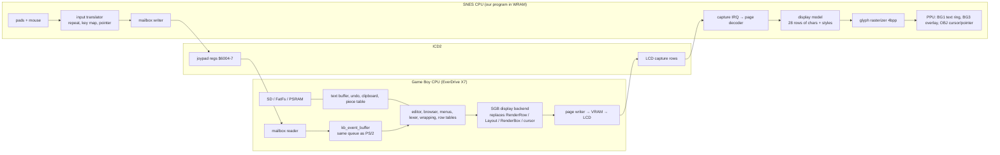
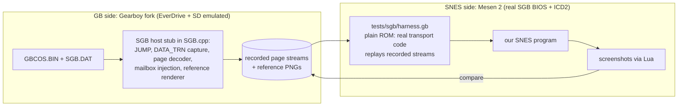

# Super Game Boy fullscreen mode (plan)

Status: **plan, nothing implemented.** Running FatPak as a fullscreen SNES
application on a Super Game Boy. **(verify)** marks documented hardware facts
(fullsnes, Pan Docs) that Phase 0 must confirm.

Today's SGB mode (DMG renderer plus `src/ui/sgb.asm`: `MLT_REQ` detection,
palettes, border from `EDITOR.DAT`, `sgb_CopyToWRAM`) stays as the **fallback**.

## Goals

- On an SGB, the editor, browser, menus and dialogs fill the 256x224 SNES screen.
  The SGB border and the 160x144 GB picture are not shown.
- Syntax highlighting and UI colors use the GBC palette values and style rules
  (`StyleLooks`, `EditorSetPalettes`). Color is per pixel instead of per 8x8 tile,
  so the GBC version's tile-grid limits don't apply.
- Every SNES pad button is used, with auto-repeat. Player 2's pad also works.
- The SNES Mouse (Mario Paint mouse) works in either port: pointer, click to place
  the cursor, drag to select, right-click for the menu, and clicks in the menus,
  browser and on-screen keyboard.
- Game launch, the cart-button menu and return to OS keep working, and launched
  games get normal SGB features (border, palettes).
- If any step fails (no `SGB.DAT`, upload error, no response from the SNES), the
  app falls back to the current SGB mode without losing data.

Non-goals for the first version: 512-pixel hi-res mode, SNES-side audio, SGB
fullscreen inside the cart-button menu (that menu stays GB-rendered under the
SGB BIOS).

## How the SGB works, and the mechanism this depends on

The SGB is a SNES cartridge containing a GB CPU/PPU and the **ICD2** chip. The SGB
BIOS (SNES code in the cartridge ROM) normally copies the GB's picture to the SNES
screen and interprets command packets. The `JUMP` command (`$12`) makes the BIOS
jump to SNES code that the GB uploaded into SNES WRAM. From then on **our SNES
program owns the SNES**: the PPU, both controller ports and the ICD2. *Space
Invaders* (1994) shipped this way.

The ICD2 is the only connection between the two CPUs. As seen from the SNES
**(verify every register on hardware)**:

| ICD2 register (SNES side) | Direction | Use in this design |
| --- | --- | --- |
| `$6000` (read) | GB → SNES | The LCD character row being captured (bits 7-3) and the current write buffer (bits 1-0) |
| `$6001` (write) / `$7800` (read) | GB → SNES | Select one of 4 row buffers, then read its 320 bytes (20 tiles × 16 bytes, SNES 2bpp format, which is byte-identical to GB 2bpp tiles when `BGP=$E4`) |
| `$6002` / `$7000-$700F` (read) | GB → SNES | Packet-ready flag and the last 16-byte packet the GB bit-banged on P1 |
| `$6003` (write) | control | GB reset (bit 7), player count for multiplayer (bits 5-4), GB clock divider (bits 1-0, SGB1) |
| `$6004-$6007` (write) | SNES → GB | The 4 "joypad" bytes the GB reads from P1, one per player ID |

That gives three channels:

1. **LCD capture (GB → SNES, bulk).** Whatever the GB displays arrives at the SNES as
   2bpp tile data. This is how `*_TRN` commands move 4 KB at a time. With our own
   SNES code we can capture data every frame. This is the main data path.
2. **Packets (GB → SNES, small).** 16 bytes per bit-banged packet. These are slow
   and only one packet is buffered. They are used for the BIOS-level bootstrap
   (`DATA_TRN`, `JUMP`), not after.
3. **Joypad registers (SNES → GB).** In 4-player mode the GB reads 4 bytes by
   cycling P1. This is the only path back to the GB, so it is a **mailbox**.

## The split: what runs where

Core decision: **the GB keeps all editor logic and becomes a "terminal client".
The SNES becomes a display and input server.** The SNES does not know about files,
the text buffer, wrapping or the lexer. It draws what the GB says and reports what
the user does.

Why not move the editor to the SNES: the text buffer, undo, clipboard, piece table
and swap file are built on PSRAM and FatFs, which only the GB can reach. A 65816
rewrite would duplicate about 20K lines and still need a slow file channel for
every edit. The terminal split keeps most existing code and replaces only the
pixel output and the input source.



| Concern | Game Boy | SNES |
| --- | --- | --- |
| SD card, FatFs, file browser listing, saves, RTC, game launch | ✔ | |
| Text buffer, undo, clipboard, large-file windows, swap file | ✔ | |
| Lexing / syntax styles (`TBLex`), wrapping (`TBScanRow`), row tables | ✔ | |
| Cursor position logic, selection logic, `PosAtX` hit testing | ✔ | |
| Menu/dialog/OSK **content and logic** (`Choose`, `osk.c`) | ✔ | |
| Fonts (glyph bitmaps + widths) | widths only (for layout) | glyphs + widths |
| Glyph rasterizing, colors, palettes, VRAM, scrolling | | ✔ |
| Menu box, bars, OSK **drawing** (overlay layer) | | ✔ |
| Text cursor sprite, mouse pointer | position/state | ✔ drawing |
| Reading pads and mouse, key repeat, button → key translation | | ✔ |
| Pointer movement, acceleration, clamping | | ✔ |
| Return to the SGB BIOS before a game launch | asks | ✔ performs |

Hit testing is split as well. The SNES sends the pointer as **(screen row, pixel x)**
and the GB resolves it with the data it already has: `PosAtX` for text rows, the
box geometry for menus, row kinds in the browser and key positions in the OSK.
The SNES never needs the editor's layout.

## Wire protocol

The protocol is defined once in `src/sgb/protocol.asm` (`DEF` constants). `build.py`
already generates `constants.h` from asm and would also generate
`snes/protocol.inc` (ca65) and a C++ header for the Gearboy test stub. Because all
three sides come from the same file, the encodings cannot drift apart.

### GB → SNES: double-buffered LCD pages

The GB keeps the LCD on with `BGP=$E4` and a **fixed** BG map that never changes in
fullscreen mode:

| LCD char rows | Tiles | Content |
| --- | --- | --- |
| 0-5 | 0-119 | **Page A**: 1,920 bytes |
| 6-11 | 120-239 | **Page B**: 1,920 bytes |
| 12 | 240-259 | **Status row**: heartbeat, busy flag, input-ack sequence. Written by the VBlank handler |
| 13-17 | blank tile | unused |

Tiles 240-259 cross 255, so the status row either takes its tiles from the `$8800`
region with one LCDC switch per frame (the renderer already switches LCDC per
line) or is cut to 16 tiles. This is decided in Phase 0.

Page format: `[seq][len lo][len hi][commands …][checksum]`. The GB writes the payload
and checksum first and the `seq` byte **last**. The SNES captures both pages every
frame and applies a page whose `seq` is newer than the last applied one and whose
checksum matches. A capture that tears while the GB is writing fails the checksum
and is retried on the next frame. The GB only refills a page after the status
channel acknowledges that page's `seq`, which provides flow control. The map never
changes, so there are no map writes and no mid-frame tricks beyond the LCDC switch.

Budget: the GB writes VRAM only in modes 0/1/2 (the SGB runs DMG-mode, with no
HDMA). The DMG renderer moves about 320 bytes per row over 40 HBlanks, so expect
**about 1-1.5 KB per frame**. Phase 0 measures the real figure.

Commands (first draft; Phase 1 fixes the encodings):

| Command | Payload | Notes |
| --- | --- | --- |
| `ROW` | screen row, font, flags, sel start/end, n, chars[n], styles RLE | Most traffic. Style bytes are `tile_attrs` (width low nibble, style high nibble) and are mostly runs, so RLE roughly halves them |
| `ROW_SAME` | screen row, source row | Repeats a row the SNES already has (after scrolls) |
| `SCROLL` | ±rows, smooth flag | The SNES rotates its BG1 ring and animates VOFS |
| `LAYOUT` | text top, text rows, bars on/off, OSK rows | Mirrors `Layout` |
| `CURSOR` | row, pixel x, look (normal/white/hidden) | The GB already computes `RenderCursorX` |
| `BOX` / `BOX_LINE` / `BOX_HI` | x, width, rows / line text / highlighted line | Menu boxes on the overlay layer. Closing a menu does not redraw text |
| `BAR` | top or bottom, text | Title and status bars on the overlay layer |
| `OSK` | layer, selected key | The SNES draws the 5×10 keyboard from a key table it already has |
| `PALETTE` | index, 15-bit colors | GBC colors are already BGR555, the SNES format |
| `BUSY`, `PROGRESS` | on/off, loaded/total KB | Loading box |
| `LAUNCH` | — | The SNES acknowledges, then returns to the BIOS (see Game launch) |
| `HELLO` / `RESET` | protocol version | Handshake and full redraw |

Big data never goes through a separate queue. The page writer serializes **dirty
rows straight from `tile_buffer`/`tile_attrs`** into VRAM. Only small control
commands use a short WRAM queue (64 bytes). That matters because WRAM0 has 17
bytes free and WRAMX has 104.

### SNES → GB: the mailbox

The SNES sets the ICD2 to 4-player mode and writes 4 bytes. The GB reads all 4
(8 nibble reads plus ID advances, about 200 cycles) once per frame in
`UpdateInput`.

- byte 0: event sequence number (writer updates bytes 1-3 first, byte 0 last; the GB reads byte 0 before and after and accepts only if both match)
- byte 1: event type
- bytes 2-3: payload

| Event | Payload | GB action |
| --- | --- | --- |
| `KEY` | key code, modifiers | Pushed into `kb_event_buffer` exactly like a PS/2 key (`KEY_*` codes from `constants.asm`) |
| `MOUSE_DOWN` / `MOUSE_DRAG` / `MOUSE_UP` | screen row (5 bits) + button, pixel x | New mouse handler (below) |
| `HELLO` / `ACK` | protocol version / page seq | Handshake; page flow control also arrives this way |

The SNES keeps a ring of pending events and advances when the GB's status row
echoes the consumed sequence. That is about 60 events/s. It is enough because the
SNES coalesces pointer motion and generates key repeat itself.

## SNES program (`snes/`, 65816, ca65)

Runs from SNES WRAM. The direct page and stack go in bank `$00` (`$7E` low mirror);
code and fonts go wherever the BIOS's working memory is not, likely bank `$7F`
**(verify in Mesen's memory viewer before choosing load addresses)**.

| Module | Job |
| --- | --- |
| `boot.s` | Entry from `JUMP`: mask interrupts, set our own NMI/IRQ, PPU init (mode 1), clear VRAM, load palettes, send `HELLO` |
| `icd2.s` | Capture: an H/V-IRQ re-armed about every 16 scanlines (about 1 ms) polls `$6000` and DMAs each finished row buffer from `$7800` (320 bytes, about 0.12 ms) into a WRAM page image. It must keep up with 4 row buffers, so the maximum latency is about 3.6 ms. Also the mailbox writer to `$6004-$6007` |
| `proto.s` | Page validation (seq/checksum), command dispatch into the display model |
| `model.s` | 28 rows × (64 chars, 64 styles, font, selection, flags, dirty bit); cursor; overlay state |
| `raster.s` | Dirty row → 256×8 4bpp row (1 KB) in WRAM: OR 1bpp glyph rows at a pixel x, with ink by style. Same algorithm and same font data as `RenderGlyph`/`RenderEncode` |
| `ppu.s` | NMI: DMA queue of finished rows to VRAM (about 4-5 KB per VBlank), BG1 VOFS/ring, OAM, palette changes |
| `overlay.s` | BG3 2bpp: bars, menu box, OSK, dialogs |
| `input.s` | Auto-joypad read of ports 1/2, mouse detection by signature, serial read of the mouse's motion bytes, sensitivity, pointer integration/acceleration, key repeat, button → event translation |
| `debug.s` | L+R+Select overlay: protocol counters, checksum failures, seq numbers, mailbox state. This is the only diagnostic view on real hardware |

**Video layout (mode 1, 256×224, 28 rows of 8 px):**

| VRAM | Size | Use |
| --- | --- | --- |
| BG1 4bpp tiles | 32 KB | 32 columns × 32 rows of unique tiles: a **scroll ring** with 4 spare rows, so smooth scrolling works like the GBC version (2 px/frame or finer) |
| BG1 map | 2 KB | 32×32, rows rotate on scroll |
| BG3 2bpp tiles | 14 KB | Overlay: bars, menus, OSK. High priority (`BGMODE` bit 3) so it draws over BG1. Color 0 is transparent |
| BG3 map | 2 KB | |
| OBJ tiles | 2 KB | Text cursor, mouse pointer (two shapes) |
| Total | about 52 KB of 64 KB | |

**Colors.** BG1 uses one 16-color palette, so ink color is **per pixel**:
0 paper, 1 selection highlight, 2 dim ink, 3 ink, 4-7 accent inks (heading blue,
code dark red, purple, brown-orange; the same values as `EditorSetPalettes`), and
8-15 the same inks on the highlight, following the GBC rule that accent ink turns
to color 3 when selected. A `PALETTE` command can change them later for
themes and inverted mode.

**Geometry.** 256 px wide with an 8 px left margin leaves 248 px rows (the GB
version has 160). That is **62 columns** with the 4 px code font and about 55 with
the VWF. Rows are capped at 64 characters. There are 28 rows: 26 text rows with
both bars, and 21 with the OSK open.

**Speed estimate.** About 64 glyphs × 8 lines per row at about 40 cycles each is
about 20K cycles, or about 6 ms at 3.58 MHz. A full 28-row redraw takes about 10
frames, the same order as the GB doing a full redraw today, and single-row edits
and scrolls fit in one frame. If that's too slow, pre-shifted glyph tables (as
the GB renderer uses) are the first optimization.

**Fonts.** `fonts.py` already emits 1bpp rows and width tables. The SNES uses the
**same bytes**. Only the code that consumes them changes.

## Game Boy side (`src/sgb/`)

| Piece | Job |
| --- | --- |
| `sgb/boot.asm` | After `sgb_Init` detects an SGB: check `/GBCSYS/SGB.DAT` (already loaded into PSRAM next to `EDITOR.DAT`), upload the SNES blob with `sgb_CopyToWRAM` (4 KB `DATA_TRN` chunks, about 12 chunks, about 1-2 s), send `JUMP`, wait for `HELLO` in the mailbox with a timeout. On success set `SYS_INFO_SGBFS`; on failure keep today's SGB mode |
| `sgb/transport.asm` | Page writer (STAT-safe VRAM copies, the DMG loop pattern), status row in VBlank, mailbox reader |
| `sgb/display.asm` | Backend that replaces `RenderRow`, `Layout`/`RenderStage`, `RenderBox`, `PlaceCursor`'s sprite write, `RenderSetPalettes`, `ShowBusy` and `ShowGameProgress` drawing. It turns them into protocol commands |
| `sgb/input.asm` | Mailbox events → `kb_event_buffer`; mouse events → `HandleMouse` |
| `editor/mouse.c` | **New, used by every mode:** click → `PosAtX(row, x)` sets the cursor; drag → anchor/cursor selection; right-click → menu; `Choose` row hit test; browser row select (second click opens); OSK key hit test; top bar → menu |

**Dispatch.** The render entry points start with a `sys_info` check and
`jp` to the SGB backend in fullscreen mode. Callers such as `editor.c` and
`browser.c` don't change. `RenderRow` already skips unchanged rows through
`bkg_buffer`. In fullscreen mode that cache becomes a 16-bit hash per row
(56 bytes), and a changed hash marks the row dirty for the page writer.

### Prerequisite refactor: screen geometry

The editor hard-codes the GB screen: `TB_ROWS 18`, `TB_STRIDE 40`, `TB_WIDTH 160`,
about 100 uses across 17 files (`text_buffer.asm`, `render.asm`, `screen.c`,
`browser.c`, `view.c`, `osk.asm`, `ingame.asm`, …). Fullscreen needs 28 rows of up
to 64 characters and 248 px.

- `tb_row_width` (px) and the row count become **runtime variables**. `TBScanRow`
  compares against a variable instead of an immediate, which costs a few cycles.
- The stride stays a compile-time constant (all indexing is `row * TB_STRIDE`).
  The plan: **stride 64 in fullscreen layout, 40 in GB layout**, selected by
  separate WRAMX `UNION`s, with indexing through a small row-address table
  (`RenderRowAddress` already exists) instead of multiplies.
- **WRAM budget (WRAMX, 4 KB):** fullscreen does not need `bkg_buffer` (760),
  `cmd_buffer` (512), `render_dma_buffer` (320), `block_states` or the GBC accent
  buffer. That frees about 1.6 KB on top of the 1.7 KB `tile_buffer` + `tile_attrs`
  already use. 26 text rows × 64 × 2 = 3.3 KB plus bar/box text just fits. If the
  measured budget doesn't fit, cap the stride at 56 (62 code columns becomes 56).
  **Phase 0d produces the real spreadsheet before Phase 2 starts.**

### ROM space

ROM0 has about 160 bytes free and every OS page is 98-100% full (0-85 bytes
each). The GB-side SGB code (estimated 2.5-4 KB) can't be resident. Options, in
order of preference:

1. **Overlay.** The [TODO](../TODO.md#os-utilities) overlay design is built first as
   general infrastructure. On SGB fullscreen, the DMG/GBC renderer's drawing code
   is dead, and the SGB backend loads from `SGB.DAT` into a page at boot.
2. The renderer shift tables and VWF bold widths now live in `EDITOR.DAT`.
   Keep the base UI font/widths resident for boot and game-menu fallback.
3. Squeeze into the existing per-page gaps (fragile; last resort).

## Data file: `bin/SGB.DAT`

A separate file so that DMG/GBC users don't load it and it can be versioned on its
own:

```
header: "SGB1", protocol version, SNES load address/bank, entry, sizes, checksum
SNES program (ca65/ld65 flat binary, linked at its WRAM address)
SNES font data (same glyph rows/widths as EDITOR.DAT's styled fonts)
GB overlay page(s) (the SGB backend, linked by rgblink at the page address)
```

`sgb_data.py` builds it next to `data_file.py`, and `make assemble` copies it to
`GBCSYS` with the other two files.

## Controls

The SNES side translates buttons into the editor's existing keyboard vocabulary,
so most of these already have handlers (PS/2 has the same keys):

| SNES | Action | Sent as |
| --- | --- | --- |
| D-pad | Move cursor (repeat after 300 ms, then every 50 ms) | arrows |
| Y + D-pad | Select | Shift+arrows |
| L / R | Page up / page down | `KEY_PGUP`/`KEY_PGDN` |
| Y + L / R | Line start / end | Home / End |
| Select + L / R | Document start / end | Ctrl+Home / End |
| B | Backspace | Backspace |
| A | Type the OSK key (OSK open), otherwise newline | key / Enter |
| X | Show/hide OSK | (existing OSK toggle) |
| Start | Menu | Escape |
| Select + Y / X / A | Cut / copy / paste | Ctrl+X/C/V |
| Select + B / Select + R… | Undo / redo | Ctrl+Z / Ctrl+Y |
| Pad 2 | Same map | |

**Mouse:** left click places the cursor, chooses menu items, browser rows (double
click opens) and OSK keys. Left drag selects, and dragging past the top or bottom
edge auto-scrolls. Right click opens the menu at the pointer (a context menu with
cut/copy/paste comes later). Sensitivity cycles with right+left click on the top
bar (the mouse's 3 hardware speeds). A future option: a scrollbar on the overlay
fed by `LinesBefore`.

PS/2: the SGB1 has **no link port**, so PS/2 is SGB2-only and keeps working there
through the existing GB driver.

## Game launch, cart menu, return to OS

This is the highest-risk area and is prototyped first (Phase 0c).

1. The browser picks a ROM, and `LaunchGame` loads it with progress shown via
   `PROGRESS`.
2. The GB sends `LAUNCH`, the SNES acknowledges, and the GB does the stock
   `_GameLaunch` handoff (`$BD07`, then wait for reset/boot).
3. The SNES **returns control to the SGB BIOS** by jumping to its reset vector.
   The BIOS reinitializes and resets the GB through the ICD2. The hypothesis is
   that the EverDrive's armed launch then boots the game with the real SGB boot
   handshake, so SGB games get their borders.
4. The cart-button menu runs under the BIOS and stays GB-rendered, as today.
5. Return to OS → `WarmMain` → SGB detected → the blob is uploaded again and
   `JUMP` runs (about 1-2 s; the BIOS may have overwritten it).

If step 3 fails (for example the GB reset returns to the EverDrive menu instead of
the game), fallbacks in order:

- Return to the BIOS **before** loading (the BIOS doesn't reset the GB on a plain
  jump into its main loop, if that's possible), then load with the GB renderer.
- Launch without SGB features.
- Show "press SNES reset to start the game" (the EverDrive already boots an armed
  game on reset).

## Build order

Risky unknowns are settled first, and test infrastructure comes before the
features it tests. Each phase has an exit check.

| # | Phase | Contents | Done when |
| --- | --- | --- | --- |
| 0a | **Hello SNES** | cc65 + Mesen 2 set up. `tests/sgb/hello.gb` (a plain ROM, no EverDrive) uploads a 65816 stub with `DATA_TRN` + `JUMP`, and the SNES paints a color | It works in Mesen **and on hardware** (launch `hello.gb` from FatPak) |
| 0b | **Channel bench** | Same ROM: the GB streams pages, the SNES counts good/torn pages; mailbox round trip; GB VRAM write rate | Measured bytes/frame, tear rate, latency; protocol constants updated |
| 0c | **BIOS handoff** | After `JUMP`, return to the BIOS and launch a game via the EverDrive | A known SGB game boots with its border, or a fallback is chosen |
| 0d | **Budgets** | WRAM spreadsheet, ROM plan (overlay or move tables), `$7F` load address check | Written into this doc |
| 1 | **Protocol spec** | `src/sgb/protocol.asm` → `.h` / `.inc` / `.hpp` generation; encode/decode round-trip tests in Python | Unit tests pass |
| 2 | **Geometry refactor** | Runtime row width/rows, stride-64 layout union, row-address table. No SGB code yet | **All existing Gearboy integration tests pass on DMG and CGB** with unchanged behavior |
| 3 | **Gearboy SGB host stub** | See Testing. `JUMP`/`DATA_TRN` capture, page decoder, reference renderer, mailbox injection, MCP/test hooks | It decodes Phase 0b's bench ROM stream correctly |
| 4 | **Overlay loader** | General overlay infrastructure (TODO item) loads the SGB backend page from `SGB.DAT` | A trivial overlay round-trips in tests |
| 5 | **GB backend: text** | Bootstrap + fallback, transport, `ROW`/`SCROLL`/`LAYOUT`/`CURSOR`, mailbox → key events | In the Gearboy stub, opening, typing, scrolling and saving a file render correctly in the reference image |
| 6 | **SNES core** | boot, icd2 capture, proto, model, raster (styles/colors), BG1 ring + smooth scroll, cursor sprite, debug overlay | The Mesen harness replaying recorded Phase 5 streams matches golden screenshots |
| 7 | **Integration on hardware** | Real FatPak OS + `SGB.DAT` on SGB1/SGB2 | Edit and save a `.c` and a `.md` file with highlighting using the pad |
| 8 | **Overlay UI** | Bars, menus (`BOX`), dialogs, browser, help, OSK, loading boxes and progress on BG3 | Every screen in the app reachable and correct; menu open/close redraws no text rows |
| 9 | **Full controls + mouse** | Complete button map, repeat, pad 2; mouse detect/pointer/sensitivity; `editor/mouse.c` hit testing (also usable on GB later) | Scripted tests in both emulators; mouse checklist on hardware |
| 10 | **Launch & return** | Implement what 0c proved; `LAUNCH` command; re-bootstrap on warm return | Launch → play → cart menu → return to OS, on hardware, 3 games (DMG-only, SGB-enhanced, CGB-dual) |
| 11 | **Polish** | Raster speed, finer smooth scroll, SGB1 clock divider experiment (verify EverDrive SPI timing), theme command, docs (README controls, ARCHITECTURE, TODO) | — |

Phases 3 and 6 can run in parallel once Phase 1 exists, because they meet only at
the protocol.

## Testing

The full app needs EverDrive emulation, which only the **Gearboy fork** has, and
SNES code needs an emulator that runs the real SGB BIOS and ICD2. No single
emulator does both. The protocol is therefore the seam, and each side is tested
against it separately:



1. **Unit (Python, existing `tests/` style).** Protocol encode/decode round trip,
   RLE, checksum, `SGB.DAT` packing, and a check that the generated `.h`/`.inc`/`.hpp`
   match `protocol.asm`.
2. **GB side in Gearboy (`make -C ../Gearboy/tests fatpak`).** Extend the existing
   HLE `SGB.cpp`, which already decodes packets and does `*_TRN` VRAM captures but
   ignores `DATA_SND`/`JUMP`, with a **FatPak host stub**:
   - record `DATA_TRN`/`DATA_SND` into a fake 128 KB SNES WRAM and assert it equals
     the blob from `SGB.DAT` byte for byte;
   - on `JUMP`, switch to host mode: capture pages from the LCD each frame, decode
     with the generated C++ header, keep the display model, and render a **reference
     image** with the same fonts and the same OR/ink rules;
   - inject mailbox events from tests or MCP (`snes_press`, `mouse_click row x`);
   - record every page stream to a file for Layer 3.

   Tests follow the existing integration style: type, select by mouse drag, menus,
   browser, OSK, large files, launch handshake (stubbed `LAUNCH` ack), fallback
   when `SGB.DAT` is missing or `HELLO` times out, and DMG/CGB regression with the
   same suite.
3. **SNES side in Mesen 2.** `tests/sgb/harness.gb` is a plain ROM (no EverDrive)
   that links the **real** GB transport code, bootstraps the SNES program the
   same way, and replays streams recorded in Layer 2. Mesen's Lua API drives
   input (pads; the mouse through input override or a recorded movie, **(verify)**)
   and saves screenshots. These are compared against Layer 2's reference images,
   pixel-exact where the rasterizer spec allows, otherwise reviewed golden images.
   Mesen's debugger has both CPUs, an event viewer for IRQ/DMA timing, and
   memory viewers for the display model.
4. **Accuracy cross-check.** Run the harness in **bsnes v115** or **ares**, which use
   SameBoy for the GB inside SGB emulation, to catch ICD2 timing that Mesen may
   allow but hardware won't.
5. **Hardware (required; emulators can't cover launch/reset).** SGB1 and SGB2 with
   the EverDrive X7, a pad on both ports, and an SNES Mouse. Checklist: boot upload
   time and fallback; page error counters in the debug overlay after 10 minutes of
   editing; every button and repeat; the mouse in each port and its sensitivities;
   launch → cart menu → return; SNES reset at any point; SGB1 speed difference.
   Test ROMs (`hello.gb`, the bench, the harness) can be launched from FatPak
   itself, so no extra cart is needed.

**Optional, if hardware iteration becomes the bottleneck:** port Gearboy's EverDrive
emulation (`EverdriveOSMemoryRule`, `EverdriveX`, `VirtualFat`, about 1,700 lines of
C++) into Mesen 2's GB core as a mapper. That gives full-stack SGB emulation of the
real OS, including launch/reset.

## Tools to install

| Tool | Why | Notes |
| --- | --- | --- |
| **Mesen 2** (standalone, latest 2.x release) | Main SNES/SGB development and debugging: runs the real SGB BIOS, emulates the ICD2, SNES Mouse, debugger for SNES and GB CPUs, Lua scripting, headless test runner | The installed `mesen-s_libretro` core in RetroArch is fine for quick smoke tests but has no debugger |
| **cc65** (`sudo apt install cc65`) | `ca65`/`ld65` for the 65816 program | Linked as a flat binary at the WRAM load address |
| **bsnes v115** or **ares** | Accuracy cross-check of ICD2 timing | Optional but recommended before hardware sessions |
| SGB BIOS dump | Required by Mesen/bsnes/ares | `~/Desktop/beisbol/Super Game Boy (World) (Rev 2).sfc` already exists; put it in Mesen's firmware folder. Add an **SGB2** dump if available (SGB2 differs: link port, clock) |
| SGB boot ROM | Some emulators want the GB-side `sgb_boot.bin`/`sgb2_boot.bin` | Build the open-source versions from `../SameBoy/BootROMs` |
| Already installed | Gearboy fork (GB-side tests), SameBoy | SameBoy's SGB is high-level emulation and **cannot run SNES code**, so it only covers today's non-fullscreen SGB mode |

Hardware: SNES/SFC, **Super Game Boy** (ideally both SGB1 and SGB2), **SNES Mouse**,
a second pad, and the EverDrive GB X7.

## Open decisions

| Question | Recommendation |
| --- | --- |
| 256 px (mode 1) or 512 px hi-res (mode 5)? | 256 px. Hi-res halves pixel width, so the 4 px fonts become unreadable on CRTs, and 4bpp at 512 px uses about 57 KB of the 64 KB VRAM |
| Stride 64 vs 56 | Decided by the Phase 0d WRAM budget |
| Separate `SGB.DAT` vs extending `EDITOR.DAT` | Separate (versioned independently; only SGB loads it) |
| Launch fallback if 0c fails | Decide after 0c; "press reset" is the safe last resort |
| Bring mouse hit testing to GB modes (iGKB mouse)? | Yes, `editor/mouse.c` is mode-independent by design |
